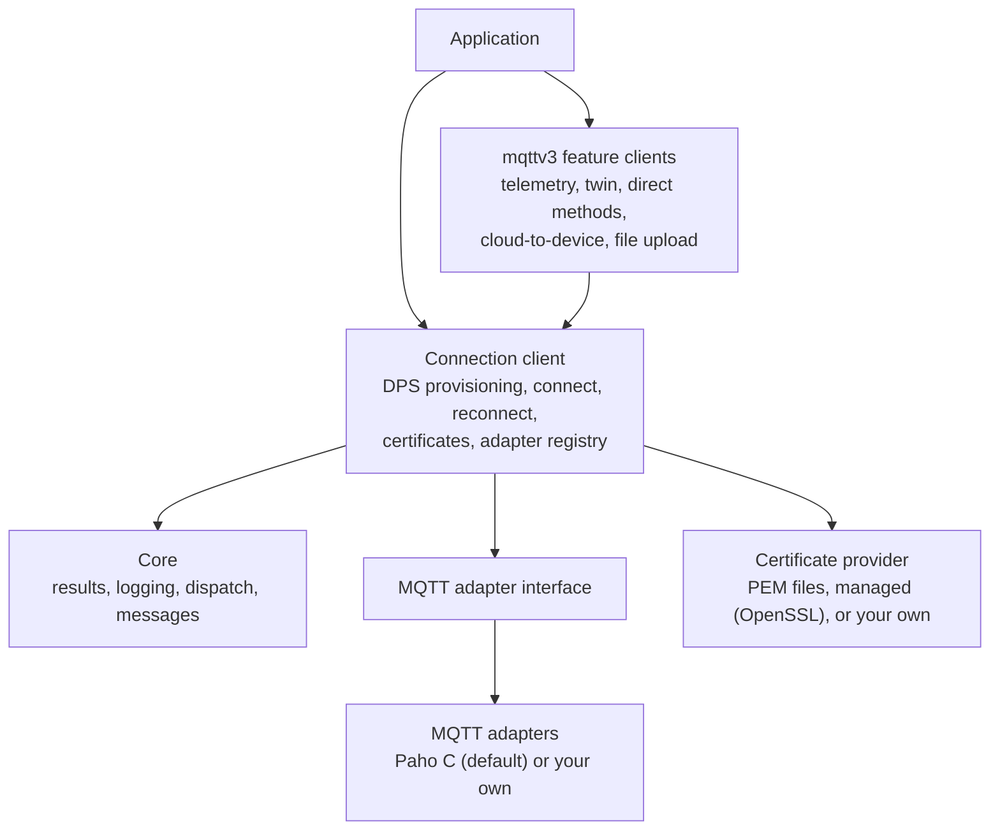

<!-- Copyright (c) Microsoft. All rights reserved.
     Licensed under the MIT license. See LICENSE file in the project root for full license information. -->

# Architecture

A C99 device SDK for Azure IoT Hub and the Azure IoT Hub Device Provisioning Service (DPS),
built for constrained and embedded devices.

- **Single-threaded API.** The connection and feature clients start no threads, and callbacks fire
  synchronously on the thread that called into the SDK. The Paho adapter runs Paho's own I/O
  threads internally and hands their events over to that thread. Callbacks are dispatched mostly
  from `az_iot_connection_client_do_work()`.
  The SDK does not lock its state against other threads: make every SDK call, for every client in
  the process, from one thread, or serialize the calls in the application. Callbacks run inside
  those calls; a callback must not wait for another thread that is calling the SDK.
  [`unified/multithreaded_telemetry`](../samples/unified/multithreaded_telemetry/README.md) hands
  data from other threads to the SDK thread.
- **No dynamic allocation in the connection and feature clients.** Buffers are caller-provided or
  live in caller-allocated structs. The reference PEM certificate provider is the exception: it
  reads the certificate, key and CA files into heap buffers once, at init.
- **Pluggable MQTT.** Any MQTT client library can be used through a small adapter interface.
  Eclipse Paho C is the default.
- **Built on [azure-sdk-for-c](https://github.com/Azure/azure-sdk-for-c)** for spans, JSON,
  logging, and the IoT Hub and DPS MQTT topic formats. It is fetched at a pinned tag
  (`AZ_SDK_C_TAG`).

## Layers

| Layer | Headers | Role |
| --- | --- | --- |
| Connection client | `az_iot_connection_client.h`, `az_iot_retry_policy.h` | One per device. Provisions through DPS, connects to the assigned hub, reconnects, and owns the MQTT session. |
| Feature clients | `mqttv3/*.h` | Protocol features. Each binds to a connection client, which delivers its messages. The connection client's `do_work()` drives their timeouts. |
| Certificate provider | `az_iot_certificate_provider.h` | Supplies TLS credentials and, optionally, handles CSRs and issued certificates. |
| MQTT adapter interface | `az_iot_mqtt_iface.h` | The contract an MQTT client library implements. |

`az_iot.h` includes the public headers.

## Hub connection profile

DPS always uses MQTT 3.1.1. The DPS assignment carries a `connectionProfile`: `"classic"`, absent
or `null` selects mqttv3 (MQTT 3.1.1, `az_iot_mqttv3_*` feature clients). The application reads
the result with `az_iot_connection_client_get_hub_profile()`.

Rules:

- A connection serves one profile at a time. Attaching a feature client of another profile fails
  with `AZ_IOT_ERR_CONNECTION_PROFILE_MISMATCH`.
- An unrecognised profile, `"mqttV5"` included, fails the connection with
  `AZ_IOT_ERR_CONNECTION_PROFILE_UNSUPPORTED`. The SDK does not guess; `connection_profile_raw`
  reports the string received.

The samples under [`samples/unified`](../samples/unified) use the mqttv3 feature clients.

## MQTT adapters

The application gives the connection client one MQTT adapter (`az_iot_mqtt_adapter`), the sizes of
its clients and a workspace. For every session the client asks the adapter's `init()` for a fresh
client of the required MQTT version, built in that workspace. The workspace holds one client at a
time.

The Paho C adapter (`az_iot_adapter_paho.h`) builds MQTT 3.1.1 clients. So does the
az_mqtt adapter (`az_iot_adapter_az_mqtt.h`, built with `AZ_IOT_WITH_AZ_MQTT=ON`): it connects and
receives inside `process_loop()` and writes sends when called, with no thread of its own, over the
[az_mqtt](../deps/az_mqtt/README.md) client from this repository. To use another MQTT library, see
[Bring your own MQTT client](how_to_byo_mqtt_client.md).

## Library boundaries

These are enforced in CI by [`eng/check-layering.sh`](../eng/check-layering.sh):

1. The core, including the connection client, never references `mqttv3_` symbols.
   It publishes the resolved profile as data.

## Further reading

- [Connecting a device](connecting.md): connection states, provisioning, reconnection, proxies,
  certificates.
- [Client configuration](client-configuration.md): build options, compile-time limits, run-time
  settings.
- [Struct versioning](struct_versioning.md): compatibility guarantees.
- [Bring your own MQTT client](how_to_byo_mqtt_client.md).
- [Samples](../samples/README.md).
