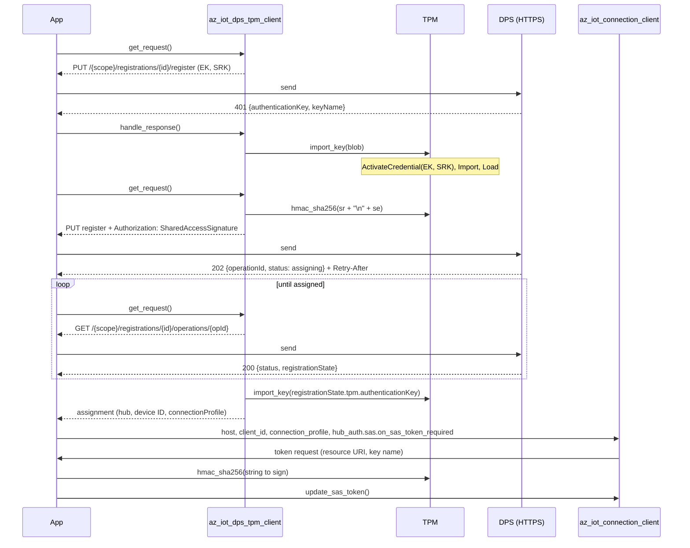
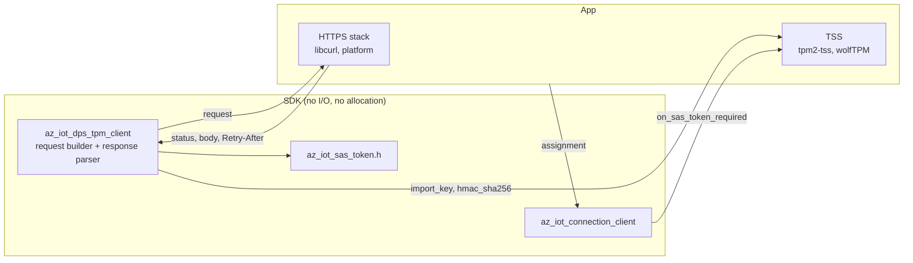
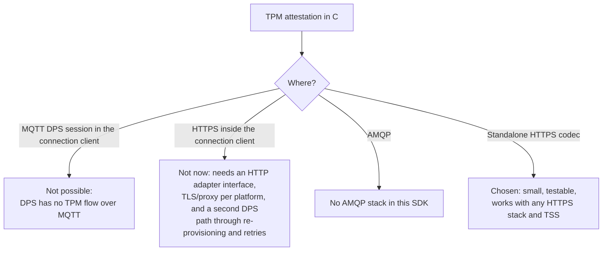

# DPS TPM attestation

Status: registration step implemented (`az_iot_dps_tpm_client.h`); no sample, no e2e test yet,
and no connection client integration (see [Remaining work](#remaining-work)).

## Problem

DPS TPM attestation proves possession of the TPM's endorsement key (EK) with a challenge: DPS
encrypts a key to the EK and storage root key (SRK), and only that TPM can import it. DPS runs
this flow over HTTPS and AMQP, not MQTT. The connection client's DPS session is MQTT, so it
cannot carry it. A TPM could already hold an X.509 key (`hsm_pkcs11`) or sign SAS tokens
(`user_provided_sas_token`), but not attest to DPS.

## Flow

The authentication key is the concatenation of TPM2B_ID_OBJECT, TPM2B_ENCRYPTED_SECRET,
TPM2B_PRIVATE, TPM2B_ENCRYPTED_SECRET and TPM2B_PUBLIC, optionally followed by UINT16-sized
encrypted data. `az_iot_dps_tpm_parse_key()` splits it into the inputs of TPM2_ActivateCredential
(credential blob, secret) and TPM2_Import (duplicate, inSymSeed, objectPublic).

## Design

- **A codec, not a transport.** The SDK has no HTTP client, and adding one (TLS, proxy,
  redirects, per platform) is out of proportion to one provisioning step. The client builds each
  request into a caller buffer and consumes each response; any HTTPS stack sends them. Same shape
  as azure-sdk-for-c's provisioning client.
- **TPM through two callbacks.** `import_key` and `hmac_sha256` are all the flow needs; the
  application keeps its TSS, handles and persistence policy.
- **States.** `REGISTER` (no token) -> 401 with key -> `AUTH_REGISTER` -> 202 -> `POLL` ->
  `assigned`. 429 and 5xx keep the request for a retry after `Retry-After` (default 3 s). A 401
  after the key exchange is `AZ_IOT_ERR_AUTH`; any other 4xx, or status `failed`/`disabled`, is
  `AZ_IOT_ERR_DPS` with the DPS `errorCode`. A failure ends the registration; `init()` restarts it.
- **SAS.** Resource URI `{scope}%2fregistrations%2f{id}`, key name from the 401 (`registration`
  if absent), a fresh token per request from the caller's Unix time.
- **Hub.** The assignment maps to a direct connection. mqttv3 hubs take the TPM-signed SAS token
  through the existing `on_sas_token_required`. mqttv5 hubs take X.509 only, so the option `csr`
  is sent and `issuedCertificateChain` returned.
- **Registration ID.** `az_iot_dps_tpm_registration_id_from_ek()` gives lowercase unpadded base32
  of SHA-256(EK), the ID the earlier Azure IoT C SDK derives.

## Alternatives not taken

## Remaining work

- **Sample** with libcurl and tpm2-tss (ESAPI): EK/SRK creation, ActivateCredential, Import,
  Load, EvictControl, HMAC.
- **E2E test** against DPS with an individual TPM enrollment, using a TPM simulator in CI.
- **Connection client integration** (optional): re-provisioning after a rejected hub identity,
  which the connection client does only over its MQTT DPS session. Until then the application
  registers again.
- **Service dependencies:** certificate issuance (`csr`) under TPM attestation, for mqttv5 hubs,
  and SAS on mqttv5 hubs. Neither is documented as supported today; a TPM-attested device can
  reach an mqttv3 hub with SAS, or an mqttv5 hub only with an X.509 credential from elsewhere.
