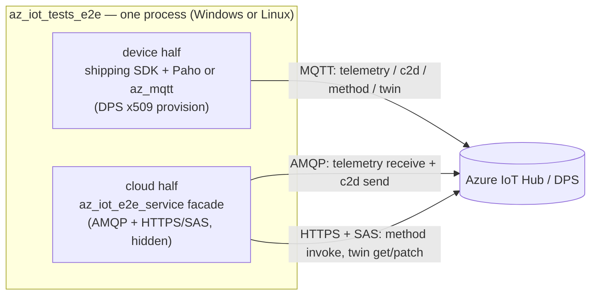

# End-to-end (e2e) tests — C SDK

This document describes the end-to-end test infrastructure for the C SDK
(`c/`). E2E tests validate real scenarios against a **live Azure IoT Hub / DPS**
instance, complementing the in-memory unit tests and the broker-gated
conformance suite.

> Scope: this infrastructure covers the C SDK only. It deliberately reuses the
> same Azure provisioning script that the dotnet CI uses. The service (cloud)
> side of each scenario is a small **in-process C facade** — there is no dotnet
> harness and no subprocess.

---

## Goals & constraints

The infrastructure was designed to satisfy these requirements:

- **SOLID — no flaky tests.** The suite is a real gate (missing cloud resources
  fail loudly, never a silent skip), uses unique per-run correlation markers,
  starts the telemetry watcher *before* the send, and always tears down its
  resource group.
- **As parallel as possible.** The OS matrix legs run concurrently, each in its
  own isolated resource group.
- **Cross-platform.** Every scenario runs on both Windows and Linux hosts, except those in
  [Not run on Windows](#not-run-on-windows).

---

## Architecture

Every scenario runs **in a single process**: one native cmocka test executable
(`az_iot_tests_e2e`) plays *both* halves and drives them cooperatively. There is
no dotnet, no subprocess, and no cross-process handshake.



The test loop interleaves `az_iot_connection_client_do_work` (device) with the
service facade's pump/poll so neither side blocks the other. Everything is
single-threaded and non-blocking.

### Device half — the shipping SDK

The device is the public SDK over an MQTT adapter, connected exactly like a
real device: **DPS provisioning with an X.509 individual enrollment**
(`dps.id_scope` set → the connection client provisions internally, then connects to the assigned hub). The connection
client builds its MQTT 3.1.1 clients with the adapter's descriptor (`mqtt_adapter`) in a heap workspace, sized in
[`e2e_mqtt_adapter.h`](../../tests/e2e/tests/e2e_mqtt_adapter.h). Each suite that connects is built once per adapter in the build:
`<suite>` over Paho and `<suite>_az_mqtt` over az_mqtt, selected in the sources with
`AZ_IOT_E2E_ADAPTER_PAHO` or `AZ_IOT_E2E_ADAPTER_AZ_MQTT`. The workflows enable both, and their
`ctest -R` filters run both. The custody suites run over az_mqtt only with OpenSSL TLS. The send
buffer in those sizes is 1 MiB + 64 KiB: the telemetry size cases publish 1 MiB + 4 KiB, plus MQTT headers. The connect flow + all four scenarios live in
[`e2e_scenarios_test.c`](../../tests/e2e/tests/e2e_scenarios_test.c); the connect
is done once for the whole suite via cmocka's group setup.

Device configuration is environment-driven (materialized to files by CI):

| Env var | Meaning |
| --- | --- |
| `AZ_IOT_DPS_ID_SCOPE` | DPS id scope (required) |
| `AZ_IOT_DPS_REGISTRATION_ID` | registration id; also the **device id** the cloud half targets (required) |
| `AZ_IOT_CLIENT_CERT` | path to the device X.509 cert PEM (required) |
| `AZ_IOT_CLIENT_KEY` | path to the device X.509 private key PEM (required) |
| `AZ_IOT_TRUSTED_CA` | path to a CA bundle PEM for TLS server auth (required) |
| `AZ_IOT_DPS_GLOBAL_ENDPOINT` | DPS global endpoint override (optional) |

### Cloud half — the `az_iot_e2e_service` facade

[`az_iot_e2e_service.h`](../../tests/e2e/service/az_iot_e2e_service.h) is a
plain-C facade that lets the test act as the cloud side **without exposing the
transport it uses**. All of the vendored AMQP (`az_amqp`) and HTTPS/SAS machinery
is confined to its implementation and linked **PRIVATE**, so a test translation
unit can never include an AMQP header. This keeps the SDK's MQTT-only device
charter intact: AMQP lives strictly behind this test boundary.

- **Telemetry** (AMQP receive): watches the Event Hub-compatible endpoint.
- **C2D** (AMQP send): sends a cloud-to-device message and awaits acceptance.
- **Direct method / twin** (HTTPS + SAS): a small pumpable HTTP/1.1 client drives
  the IoT Hub REST API so it interleaves with the device's pump.

Service configuration (set by the provisioning config script):

| Env var | Meaning |
| --- | --- |
| `IOTHUB_CONNECTION_STRING` | IoT Hub service policy connection string (c2d / method / twin); optional with `IOTHUB_SERVICE_ACCESS_TOKEN` |
| `IOTHUB_SERVICE_ACCESS_TOKEN` | Microsoft Entra access token for `https://iothubs.azure.net` (optional). When set, it authorizes every hub service call instead of SAS (`Bearer`, on REST and on the AMQP CBS put-token), for a hub with local authentication disabled |
| `IOTHUB_HOSTNAME` | IoT Hub host name for `IOTHUB_SERVICE_ACCESS_TOKEN` (optional; else that of `IOTHUB_CONNECTION_STRING`) |
| `IOTHUB_EVENTHUB_CONNECTION_STRING` | Event Hub-compatible endpoint connection string (telemetry); no key needed with `IOTHUB_EVENTHUB_ACCESS_TOKEN` |
| `IOTHUB_EVENTHUB_ACCESS_TOKEN` | Microsoft Entra access token for `https://eventhubs.azure.net` (optional). When set, telemetry is read with it (CBS token type `jwt`) instead of SAS. The built-in endpoint accepts only SAS, so this needs device messages routed to an Event Hub |
| `IOTHUB_EVENTHUB_LISTEN_NAME` | Event Hub entity name (optional; else from the connection string) |
| `IOTHUB_EVENTHUB_PARTITION_COUNT` | partitions to watch (optional; default 4) |
| `IOTHUB_EVENTHUB_CONSUMER_GROUP` | consumer group to read (optional; default `$Default`) |

The telemetry watcher only receives messages enqueued from 5 minutes before it
starts (an Event Hubs enqueued-time filter), so a reused hub's backlog is skipped.
That window still holds every device's traffic on a shared hub (often hundreds of
messages), so each test starts the watch with a capture filter (its device id or
marker): only bodies containing it enter the watcher's 64-message capture ring, and
other traffic cannot evict a marker the test is about to check.

Concurrent runs share the consumer groups, and Event Hubs detaches a sixth reader of
a partition in a group. When a receiver is detached, the watcher logs
`[e2e] telemetry: the service detached the receiver of partition <n>`, waits 5 s and
reconnects, reading again from the time the watch began. The replayed events are
dropped by their per-partition sequence number, so none is captured twice. The
reconnect closes the socket without waiting, and each `do_work` call advances the
connection setup by at most one step. Setup ends once every receiver's attach is
answered, and fails after 60 s. `az_iot_tests_e2e_amqp_telemetry` covers replay
dropping, the reconnect and the setup deadline against an in-memory Event Hubs
peer, with no live service.

SAS tokens are built with OpenSSL (HMAC-SHA256 + base64) on both platforms. Note
the two key conventions the facade handles: Event Hubs signs with the **raw** key
string, while IoT Hub **base64-decodes** the key first. With `IOTHUB_SERVICE_ACCESS_TOKEN` set,
the IoT Hub calls send that token instead, and `IOTHUB_REGISTRY_CONNECTION_STRING` is not used.

### Scenarios

The suite runs four scenarios in one process, each with a unique per-run
correlation marker so a fresh hub never confuses stale data:

1. **telemetry** — the device publishes a marked message; the cloud half observes
   it on the Event Hub endpoint. The watcher starts *before* the send (so nothing
   is missed) and is released afterwards.
2. **c2d** — the cloud sends a marked message; the device's C2D handler receives
   and matches it.
3. **direct method** — the cloud invokes `echo`; the device echoes the payload
   back with `200`; the cloud asserts the status and body.
4. **twin** — the cloud patches a desired property (the device observes it), then
   the device reports a property (the cloud reads it back via a twin GET).

**SAS suites** (every run; a DPS symmetric-key enrollment group, provisioned or
shared; env `AZ_IOT_DPS_SAS_GROUP_KEY`, `AZ_IOT_DPS_SAS_REGISTRATION_ID`,
`AZ_IOT_DPS_ID_SCOPE`, `AZ_IOT_TRUSTED_CA`):

- [`e2e_sas_test.c`](../../tests/e2e/tests/e2e_sas_test.c) — DPS and hub over SAS
  from the group key, then telemetry. `ci-c-e2e`.
- [`e2e_fileupload_test.c`](../../tests/e2e/tests/e2e_fileupload_test.c) — its
  SAS-key scenario uploads a file as `<AZ_IOT_DPS_SAS_REGISTRATION_ID>-fu`.
- [`e2e_csr_sas_test.c`](../../tests/e2e/tests/e2e_csr_sas_test.c) — DPS over SAS
  with a CSR; the hub over the DPS-issued certificate, then telemetry. Also needs
  `AZ_IOT_BUILD_E2E_CSR` (group linked to the signing CA). `ci-c-e2e` (`test_csr`).

**TPM suite** (built with every e2e build and run by `ci-c-e2e` on Linux and Windows, on pull
requests and on main; env `AZ_IOT_DPS_ID_SCOPE`, `IOT_DPS_CONNECTION_STRING` (a DPS policy with
EnrollmentWrite and RegistrationStatusWrite), `IOTHUB_CONNECTION_STRING` (or `IOTHUB_HOSTNAME` and
`IOTHUB_SERVICE_ACCESS_TOKEN`), `IOTHUB_EVENTHUB_CONNECTION_STRING`; optional
`IOTHUB_REGISTRY_CONNECTION_STRING` (RegistryWrite, its policy signs the device delete when there
is no `IOTHUB_SERVICE_ACCESS_TOKEN`) and `AZ_IOT_TRUSTED_CA`):

- [`e2e_tpm_test.c`](../../tests/e2e/tests/e2e_tpm_test.c) — a TPM simulated in software
  (`samples/common/sample_tpm_sim.c`) gets a new individual enrollment through the DPS service
  API, registers over HTTPS, connects to the assigned mqttv3 hub with TPM-signed SAS tokens and
  sends telemetry. It then deletes the device and its enrollment, expects the hub to refuse the
  identity, enrolls it again under a new device ID, registers again and sends again. The enrollment, registration and device are deleted.
  `ci-c-e2e`.

---

## Build & CMake wiring

- CMake option `AZ_IOT_BUILD_E2E` (default **OFF**) in
  [`c/cmake/az_iot_options.cmake`](../../cmake/az_iot_options.cmake).
- [`c/tests/CMakeLists.txt`](../../tests/CMakeLists.txt) adds the `e2e`
  subdirectory when `AZ_IOT_BUILD_E2E` is ON; the configure step fails unless Paho or
  az_mqtt is built (the device half needs a real MQTT adapter).
- [`c/tests/e2e/CMakeLists.txt`](../../tests/e2e/CMakeLists.txt) builds the
  vendored `az_amqp` (under `c/tests/deps/amqp`, test-only), the
  `az_iot_e2e_service` facade, and the `az_iot_tests_e2e` cmocka executable
  (registered with CTest as `az_iot_tests_e2e`, so `ctest -R e2e` selects it).

Build & run locally (needs provisioned Azure + the env vars above):

```pwsh
# from c/  (Windows needs a VS dev shell; Linux needs ninja)
cmake --preset windows-msvc-debug -DAZ_IOT_BUILD_E2E=ON -DAZ_IOT_WITH_PAHO=ON -DAZ_IOT_WITH_AZ_MQTT=ON
cmake --build --preset windows-msvc-debug --config Debug --target az_iot_tests_e2e az_iot_tests_e2e_az_mqtt
ctest --test-dir build/windows-msvc-debug -C Debug -R e2e --output-on-failure
```

---

## CI pipelines

### `ci-c-e2e` (Azure Pipelines)

[`.azure-pipelines/ci-c-e2e.yml`](../../../.azure-pipelines/ci-c-e2e.yml)
([`templates/jobs-c-e2e.yml`](../../../.azure-pipelines/templates/jobs-c-e2e.yml)) runs on every
pull request to `main` and `releases/public-preview`, nightly (11:00 UTC on `main`, 14:00 UTC on
`releases/public-preview`) and on demand. It has no push trigger: both branches require pull
requests to be up to date and squash-merged. A `changes` job skips the work of a pull request that
changes nothing under `c/`, `common/` (Markdown aside) or `.azure-pipelines/`, and the `gate` job
(**C e2e gate**) is the single result to require.

| Job | Runs on | Purpose |
| --- | --- | --- |
| `setup` | ubuntu | scheduled and manual runs only: provisions one resource group (IoT Hub + DPS + Event Hubs) and publishes the encrypted test configuration |
| `setup_csr` | ubuntu | scheduled and manual runs only: provisions a certificate-management resource group (IoT Hub + DPS linked to Azure Device Registration) and publishes its encrypted test configuration |
| `setup_samples` | ubuntu | scheduled and manual runs only: provisions the samples' resource group (IoT Hub + DPS + Event Hubs, file upload) |
| `setup_samples_csr` | ubuntu | every run: provisions the CSR samples' certificate-management resource group |
| `openssl` | windows, ubuntu | builds OpenSSL 4.1.0 into the pipeline cache once per image |
| `test` | ubuntu (OpenSSL 3.0 and 4.1.0) + windows (4.1.0), 4 groups each | builds the e2e tests, materializes its device's X.509 material, and runs its group: `core` (every e2e suite but the three below, plus custody on Linux), `transport_paho`, `transport_az_mqtt`, `sas` (both adapters) |
| `test_csr` | ubuntu (OpenSSL 3.0) + windows (4.1.0) | builds and runs the CSR suites (`e2e_csr`, both adapters) on its own bootstrap device; the Linux job publishes `coverage-trace-e2e-csr` |
| `coverage` | ubuntu | merges the four OpenSSL 3.0 groups' tracefiles into `coverage-trace-e2e`, only when every `test` job passed |
| `coverage_combined` | ubuntu | not on pull requests, nor in the gate: the combined coverage report ([code-coverage.md](code-coverage.md#nightly-combined-coverage)) |
| `esp32_qemu` | ubuntu, esp32, esp32c3 and esp32s3 (matrix) | the ESP32 IoT Hub sample in QEMU, always on the shared environment ([ESP32 in QEMU](#esp32-in-qemu)) |
| `samples` | ubuntu + windows, 2 adapters x 2 shards each | the connecting samples (`samples_mqttv3`, [Samples](#samples)) |
| `samples_csr` | ubuntu + windows, 2 adapters each | the certificate-management samples (`samples_csr`), always on their provisioned environment |
| `teardown`, `teardown_csr`, `teardown_samples` | ubuntu | scheduled and manual runs only: delete the resource groups, even when a job failed or the run was canceled |
| `teardown_samples_csr` | ubuntu | every run: deletes the CSR samples' resource group |

Each `test` job has its own device (index os-index * 4 + group-index) and Event Hubs consumer
group, so the groups run in parallel without sharing a device, twin or reader quota (Event Hubs
allows 5 readers per partition per consumer group).

**Local authentication disabled.** The tests reach the hub and the Event Hub with Microsoft Entra
tokens only. Each job takes the pipeline service connection principal's tokens for
`https://iothubs.azure.net` (`IOTHUB_SERVICE_ACCESS_TOKEN`) and `https://eventhubs.azure.net`
(`IOTHUB_EVENTHUB_ACCESS_TOKEN`) right before the tests, which run without the Azure CLI login. The
tokens are not refreshed and live 60-90 minutes, longer than a job. The CSR suites make no hub
service calls, so `test_csr` takes no tokens. The built-in Event
Hub-compatible endpoint accepts only shared access keys, so device messages are routed to an Event
Hub (`telemetry`, 4 partitions, consumer groups `e2e-0`..`e2e-11`) in a namespace with local
authentication disabled; the hub sends with its system-assigned identity (**Azure Event Hubs Data
Sender**). Devices keep their X.509 and SAS credentials, and DPS its connection string.

**Provisioned environment (scheduled and manual runs).** `setup` creates the hub with
`disableLocalAuth=true` (`iot-sdks-e2e-fx` `-DisableLocalAuth`), grants the principal **IoT Hub
Data Contributor** on it and **Azure Event Hubs Data Receiver** on the Event Hub, and creates one
consumer group per job (`e2e-<index>`). Those role assignments take up to five minutes to apply,
so each test job waits until five minutes after them before it runs the suites. The configuration
is published encrypted, its key passed to the test jobs as a secret output.

**Shared environment (pull requests).** Pull request runs (and manual runs with pipeline parameter
`environment` set to `shared`) skip `setup` and `teardown` and use a
long-lived IoT Hub, DPS and Event Hub, whose settings Key Vault `kv-aziotclb` holds (pipeline
parameter `sharedKeyVault`). Each job reads them with the service connection and issues its own
device certificate from the DPS X.509 enrollment group's CA
([`c/eng/e2e-shared-device.ps1`](../../eng/e2e-shared-device.ps1) `-EntraAuthentication`,
registration ID `ci-ado-<build>-<attempt>-<index>`); the SAS suite registers under the DPS
symmetric-key enrollment group. Its secrets:

| Secret | Value |
| --- | --- |
| `E2E-SHARED-GROUP-CA` | base64 of a PEM holding the X.509 enrollment group's CA certificate and its private key |
| `E2E-SHARED-IOTHUB-HOSTNAME` | IoT Hub host name |
| `E2E-SHARED-EVENTHUB-KEYLESS-CS` | `Endpoint=sb://<namespace>.servicebus.windows.net/;EntityPath=<event hub>`, no key |
| `E2E-SHARED-EVENTHUB-PARTITION-COUNT` | that Event Hub's partition count |
| `E2E-SHARED-ID-SCOPE` | DPS ID scope |
| `E2E-SHARED-SAS-GROUP-KEY` | primary key of the DPS symmetric-key enrollment group |
| `E2E-SHARED-DPS-CS` | DPS policy with EnrollmentWrite and RegistrationStatusWrite, for the TPM suite |

The principal needs **Key Vault Secrets User** on the vault, **IoT Hub Data Contributor** on the
hub and **Azure Event Hubs Data Receiver** on the Event Hub, which needs consumer groups
`e2e-0`..`e2e-11` and, for the samples, `samples-0`..`samples-7`. Jobs pick consumer groups from the build ID and device index, so a run uses
each at most twice. The hub routes device messages to that Event Hub and to the built-in
endpoint, and needs file upload with notifications. The TPM suite deletes its enrollment and
device; other devices the runs register stay in the shared hub. Pull requests from forks get no
service connection and fail.

**CSR environment.** The CSR suites need DPS enrollment groups linked to a certificate policy of
Azure Device Registration, which issues the devices' operational certificates. `setup_csr`
provisions one (`provision.ps1` suite `c-e2e-csr`, hub `disableLocalAuth=true`) with one bootstrap
identity under the X.509 group per `test_csr` job (`IOT_DPS_GROUP_X509_*_<index>`), so both run in
parallel. On the shared environment, each `test_csr` job issues its bootstrap device from the
group's issuing CA ([`e2e-shared-device.ps1`](../../eng/e2e-shared-device.ps1) `-Csr`, registration
ID `ci-ado-csr-<build>-<attempt>-<index>`), with these secrets of the same vault:

| Secret | Value |
| --- | --- |
| `E2E-CSR-SHARED-GROUP-CA` | base64 of a PEM holding the X.509 group's issuing CA certificate and its private key, then any CA certificates above it (issuer first) |
| `E2E-CSR-SHARED-ID-SCOPE` | DPS ID scope |
| `E2E-CSR-SHARED-DPS-HOST` | DPS device endpoint |
| `E2E-CSR-SHARED-SAS-GROUP-KEY` | primary key of the symmetric-key group linked to the same certificate policy |

See [`.azure-pipelines/README.md`](../../../.azure-pipelines/README.md) for the scripts it shares
with the .NET pipelines and the permissions it needs.

### GitHub Actions workflows

The other C e2e workflows (`ci-c-e2e-mqttv5` and `ci-c-e2e-adu`) end with a
`<workflow>-gate` job (`ci-c-e2e-mqttv5-gate`, `ci-c-e2e-adu-gate`), the
single check name for rulesets to require. Since its workflow runs on every pull request
(`ci-c-e2e-mqttv5` and `ci-c-e2e-adu`: every pull request to `releases/public-preview`), it
always reports; it fails only when a job failed or was cancelled. The other C workflows end with
`ci-c-gate`, `ci-c-static-analysis-gate`, `codeql-c-gate` and `ci-c-yocto-gate`.

They log in with OIDC via `azure/login@v2`, using repo secrets `AZURE_CLIENT_ID`,
`AZURE_TENANT_ID`, `AZURE_SUBSCRIPTION_ID` (same secrets as the dotnet CI), and grant
`permissions: id-token: write`. Each provisioning job downloads the shared
[`iot-sdks-e2e-fx`](https://github.com/Azure/iot-sdks-e2e-fx) script and:

1. computes the RG name from the run itself (`CSDKE2E<Flavor>-<run_id>-<run_attempt>`, a
   workflow-level `env`) and passes it to the provision action as `rg-name`;
2. provisions IoT Hub + DPS + enrollments (`New-AzIotTestEnvironment`);
3. emits an env-var script that is dot-sourced (`New-AzIotCSDKE2ETestConfig -Target powershell`);
4. **always** (`if: always()`) deletes the resource group (`az group delete --no-wait`).

The RG name is deliberately *derived from the run* rather than published as a
setup job output: **a cancelled job does not propagate its `outputs`**, so a
teardown reading `needs.setup.outputs.rg` would receive an empty string and
delete nothing while the group stayed behind. Because teardown
recomputes the same name, it cleans up even when `setup` is cancelled or times
out; `destroy-e2e-resources` no-ops when the group was never created.

[`cleanup-e2e-resources.yml`](../../../.github/workflows/cleanup-e2e-resources.yml)
is the nightly backstop: it reaps any `CSDKE2E*` (C), `DotnetE2ETestPipeline-*`
(dotnet) or `DotnetLonghaul-*` (dotnet longhaul) group older than 8 h (via
`Remove-LeftoverAzureResourceGroups`),
covering what teardown structurally cannot — an asynchronous `--no-wait` delete
failure, or a runner that dies before teardown.

`ci-c-e2e-mqttv5.yml` and `ci-c-e2e-mqttv5-adr-namespace.yml` serve `releases/public-preview` only.

---

## ESP32 in QEMU

[`e2e_esp32_qemu_test.c`](../../tests/e2e/tests/e2e_esp32_qemu_test.c)
(`az_iot_tests_e2e_esp32_qemu`, `-DAZ_IOT_BUILD_E2E_ESP32_QEMU=ON`, POSIX hosts) plays only
the service. The device is the [ESP32 IoT Hub sample](../../samples/unified/esp32/README.md)
firmware in Espressif's QEMU. The test starts it with `E2E_ESP32_QEMU_COMMAND` (through
`/bin/sh -c`, in its own process group) and reads the sample's stable `hub_esp32:` log lines.
It runs the firmware through the child-process helper below.
`E2E_ESP32_DEVICE_ID` is the registration id the firmware was built with. Once the firmware
logs `hub_esp32: ready on`:

1. **telemetry** — `{"deviceId":"<id>",...}` reaches the Event Hub endpoint;
2. **direct method** — `echo` answers `200` with its marked payload;
3. **twin** — the test patches a marked desired property; the firmware logs
   `desired version <v> acknowledged` and a twin GET shows `"desiredVersion":<v>` in reported.

[`eng/esp-idf-qemu-e2e.sh`](../../eng/esp-idf-qemu-e2e.sh) `<target> <cert.pem> <key.pem>`
runs it all in an ESP-IDF environment with QEMU, a host compiler and OpenSSL headers:

1. builds the sample's `qemu` firmware with the device's DPS settings (`SDKCONFIG_EXTRA`
   for [`eng/esp-idf-build.sh`](../../eng/esp-idf-build.sh));
2. writes the identity with [`eng/esp-idf-qemu-identity.sh`](../../eng/esp-idf-qemu-identity.sh):
   - esp32: an `esp_secure_cert` partition holding the certificate and key;
   - esp32c3 and esp32s3: the key goes into the Digital Signature peripheral. The script boots
     QEMU in download mode, and `configure_esp_secure_cert.py --configure_ds` burns the DS key
     into an emulated eFuse image and writes the partition with the encrypted DS parameters. The
     esp32c3 DS takes RSA keys of at most 3072 bits;
3. builds and runs the test, booting the firmware with
   [`eng/esp-idf-qemu.sh`](../../eng/esp-idf-qemu.sh) `--run`.

CI: job `esp32_qemu` in [`ci-c-e2e`](#ci-c-e2e-azure-pipelines). It runs esp32, esp32c3 and
esp32s3 in `espressif/idf:v6.1`, with devices 12, 13 and 14 issued by `e2e-shared-device.ps1`. It
uses the shared environment on every run, nightly included: the per-run enrollments' RSA-4096 keys
exceed the esp32c3 DS's 3072 bits, while the shared group CA issues RSA-2048.

### Child-process helper

[`tests/support/e2e_process.h`](../../tests/support/e2e_process.h) runs a program as a child, on
POSIX and Windows, for suites whose device is another process: it starts an argument list or a
shell command (environment variables set or removed for the child only), captures stdout and stderr through
one pipe, echoes whole lines with a prefix, waits for a text while calling a pump (here the
service facade), and stops the child: SIGTERM to its process group (Windows: `CTRL_BREAK_EVENT`
to its process group), then SIGKILL (Windows: its job object is terminated) after a grace period.
It is built in every build, not only with `AZ_IOT_BUILD_E2E`, and its test,
`az_iot_tests_e2e_process`, runs in `ci-c`'s unit-test ctest on Linux and Windows.

---

## Samples

[`e2e_samples_test.c`](../../tests/e2e/tests/e2e_samples_test.c) runs each connecting sample
against an mqttv3 hub and checks its work from the service side. CMake option
`AZ_IOT_BUILD_E2E_SAMPLES` (needs `AZ_IOT_BUILD_E2E`, `AZ_IOT_BUILD_SAMPLES` and
`AZ_IOT_BUILD_SAMPLES_WITH_PIPELINE_HOOKS`) registers one CTest test per sample and adapter,
`az_iot_samples_e2e_<group>_<name>_<adapter>`, labelled `samples_mqttv3`, or `samples_csr` for the
samples that need a certificate-management environment. A sample in scope that is not built fails
the configure.

Each test:

1. gives the sample only the variables it reads (its README): the leg's X.509 device, or a
   registration ID of its own (`<leg registration ID>-<suffix>`), and a work directory. The
   service connection strings are removed from its environment;
2. starts it, lets it run to its own end (unified samples 60 s; the one-shot samples their own
   timeouts), and stops it only past the test's own limit;
3. requires `sample-pipeline: end rc=0` and exit code 0, then the check below.

| Sample | Check |
| --- | --- |
| `unified/telemetry`, `connect_first`, `websockets`, `multithreaded_telemetry` | Telemetry of that device reaches the Event Hub endpoint, enqueued after the test started (the watcher filters on `iothub-connection-device-id`). |
| `unified/proxy` | Same, and the proxy's log shows a `CONNECT` to port 8883 ([proxy.py](https://github.com/abhinavsingh/proxy.py), log in `AZ_IOT_SAMPLES_E2E_PROXY_LOG`). |
| `unified/twin_get_patch` | A twin GET shows reported `sample` = `hello`, `$lastUpdated` after the start. |
| `unified/direct_method_responder`, `direct_method_slow_responder` | Once the hub session is up, `echo` (`slowEcho`) answers 200 with the payload echoed; retried while the device is not subscribed. |
| `unified/c2d_receiver` | Once the hub session is up, one C2D message is sent; the sample prints it and `Received N message(s).`, N >= 1. |
| `unified/file_upload` | The hub's file-upload notification for that device and `sample-data/test.txt`, within 240 s: watchers of concurrent runs compete for the hub-wide endpoint. A lost watcher is reattached; on a miss, the test lists every notification delivered to it (device, blob, enqueued time, AMQP delivery count, disposition). |
| `authentication/dps_sas_key` | Telemetry `"auth":"sas-key"`; the sample gets `AZ_IOT_DPS_ENROLLMENT_GROUP_KEY`. |
| `authentication/user_provided_sas_token` | rc 0 only; it gets `AZ_IOT_DPS_SYMMETRIC_KEY` derived from the group key. |
| `authentication/hsm_pkcs11` | Telemetry `"custody":"hardware"`; the device key in a SoftHSM2 token, `OPENSSL_CONF` (from `AZ_IOT_SAMPLES_E2E_PKCS11_OPENSSL_CONF`) for this sample only. |
| `authentication/dps_csr_managed` (`samples_csr`) | Prints `[dps_csr] telemetry sent with operational certificate`; telemetry `"source":"dps_csr_managed"`. |
| `authentication/custom_certificate_provider` (`samples_csr`) | Prints `[custom_cert] connected with operational identity`. |
| `authentication/dps_persist_assignment` (`samples_csr`) | Two runs in one work directory: the first registers with DPS and saves the assignment, the second prints `(restored assignment)` once connected to the saved hub. |
| `authentication/hub_renew` (`samples_csr`) | Registers with a CSR, renews over the hub (resubmitting if the hub ends the session first, as it often does right after the CSR registration) and prints `[hub_renew] reconnected with the renewed operational certificate`. |
| `authentication/dps_sas_key_issued_cert` (`samples_csr`) | Telemetry `"auth":"sas-key,x509-issued"`; the sample gets the certificate-management environment's `AZ_IOT_DPS_ENROLLMENT_GROUP_KEY`. |
| `authentication/dps_tpm`, `dps_tpm_tss` | `--enrollment` first; the test creates the TPM individual enrollment, then telemetry `"attestation":"tpm"`. The enrollment and device are always deleted. `dps_tpm_tss` runs against an swtpm the test starts. |

CI: the `samples` and `samples_csr` jobs of [`ci-c-e2e`](#ci-c-e2e-azure-pipelines), with the
service connection principal's Microsoft Entra tokens ([`run-c-samples.ps1`](../../../.azure-pipelines/scripts/run-c-samples.ps1)).

- Jobs: {ubuntu-24.04, windows-latest} x {paho, az_mqtt} x shard {0, 1}, with the image's OpenSSL.
  Shard 0 is telemetry, connect_first, websockets, proxy, multithreaded_telemetry, dps_sas_key
  and user_provided_sas_token; shard 1 the rest. A job runs its samples one after the other on
  its device.
- Slot = os-index * 4 + adapter-index * 2 + shard (0..7). Each job reads events on consumer group
  `samples-<slot>`.
- Pull requests use the shared environment: device index = slot, registration ID
  `ci-ado-samples-<build>-<attempt>-<slot>` (`e2e-shared-device.ps1 -EntraAuthentication`).
- Scheduled and manual runs provision `CSDKE2ESamples-Ado-<project>-<build>` (8 X.509
  enrollments, the SAS group, file upload, device messages routed to an Event Hub with consumer
  groups `samples-0`..`samples-7`) and always delete it. Its own hub, since the samples' file-upload
  watchers would compete with the e2e tests'.
- Each job publishes its JUnit and, as an artifact, each sample's `sample-output.log` and the
  proxy log.
- CSR jobs (`samples_csr`): {ubuntu-24.04, windows-latest} x {paho, az_mqtt}, slot 0..3. Every run,
  pull requests included, provisions `CSDKE2ESamplesCert-Ado-<project>-<build>` (certificate
  management, hub `disableLocalAuth=true`, an X.509 enrollment group with four devices, the SAS
  group, both linked to the signing CA) and always deletes it: the shared CSR environment gives no
  hub or Event Hub access. A job uses group identity `IOT_DPS_GROUP_X509_*_<slot>` as its bootstrap
  device and consumer group `samples-<slot>` of the Event Hub its telemetry is routed to, like the
  other samples jobs; once Azure Device Registration links the hub, `az iot hub` refuses to update
  it, so that routing is written through Azure Resource Manager. Two jobs run at a time: with all four registering with a CSR at once, DPS left
  some registrations unanswered past the samples' 60 s.

Not in these jobs: the samples that do not connect, which are CTest tests of `ci-c` already;
`unified/esp32` ([ESP32 in QEMU](#esp32-in-qemu)). Windows: see [Not run on Windows](#not-run-on-windows).

Run locally, with the variables above (as `run-c-samples.ps1` sets them) and
proxy.py listening:

```pwsh
# from c/
cmake --preset linux-gcc-debug -DAZ_IOT_WITH_PAHO=ON -DAZ_IOT_WITH_AZ_MQTT=ON -DAZ_IOT_BUILD_E2E=ON `
  -DAZ_IOT_BUILD_SAMPLES_WITH_PIPELINE_HOOKS=ON -DAZ_IOT_BUILD_E2E_SAMPLES=ON
cmake --build --preset linux-gcc-debug --target az_iot_tests_e2e_samples
ctest --test-dir build/linux-gcc-debug -L samples_mqttv3 -R '_paho$' --no-tests=error --output-on-failure
```

---

## Not run on Windows

Every other e2e suite runs on Linux and on Windows (MSVC; Paho over OpenSSL 4.1.0, az_mqtt over
Schannel), on every pull request and main run of its workflow.

| Suite | Why |
| --- | --- |
| `az_iot_tests_e2e_custody` | The device key is in a PKCS#11 token (SoftHSM2) reached through the OpenSSL pkcs11 provider. The provider has no MSVC build (it needs a POSIX `dl` library) and the runner's OpenSSL is an MSVC build. az_mqtt on Windows uses Schannel, which takes no key references. |
| `az_iot_tests_e2e_amqp_transport_sigpipe` | Tests SIGPIPE, which Windows does not have. |
| Samples `authentication/hsm_pkcs11`, `authentication/dps_tpm_tss` | As the custody suite: no pkcs11 provider for MSVC. tpm2-tss and swtpm are not built for Windows. |

---

## Conventions & gotchas

- **Always a real gate, never a skip.** The suite connects the device and
  creates the service facade in cmocka's group setup; if any prerequisite (env
  var, cloud resource, device connect) is missing, group setup returns non-zero
  and the whole suite **fails** with an actionable message. These tests run only
  against real Azure resources (the ci-c-e2e pipeline, or a deliberate local run
  with the e2e-fx config dot-sourced), so there is no "skipped but green" path to
  hide a broken setup.
- **CA bundle without downloads.** [`eng/e2e-trusted-ca.ps1`](../../eng/e2e-trusted-ca.ps1)
  writes it: the OpenSSL system bundle on Linux, the `Root` stores on Windows. Avoid
  fetching roots over the network.
- **TLS state per connection.** The vendored reference transport keeps each
  connection's TLS state (Schannel on Windows, OpenSSL on Linux) in its own
  storage, so service connections can be open at the same time.
- **Resource quotas are hard limits.** Provisioning per matrix leg keeps tests
  isolated but multiplies resource usage; keep the matrix lean and always delete
  the RG.
- **HTTPS calls without a response are retried when safe.** A connection can
  stall with no response at all. The service facade sends a request again on a
  new connection (3 attempts, 2 s apart) when none of it was sent, or when it is
  idempotent (the DPS and device DELETEs, and the twin GET and desired PATCH;
  20 s per attempt instead of 60 s). This holds for the blocking calls and for
  those driven with `az_iot_e2e_service_request_poll()`, which pause without
  blocking. Each failed attempt is logged with its phase, bytes sent and
  received, and the transport's error.
- **DPS provisioning has its own time budget.** DPS assignment intermittently
  takes from tens of seconds to over 90 s. Connect waits charge time to DPS
  while the client's DPS scope is active, with a budget of 180 s
  (`tests/e2e_connect_clock.h`), and to the hub otherwise, with the suite's
  connect timeout. Each connect logs both times.

---

## Adding a new scenario

1. **Device side:** in [`e2e_scenarios_test.c`](../../tests/e2e/tests/e2e_scenarios_test.c)
   add a `test_*` function and register it with
   `cmocka_unit_test_teardown(test_*, detach_feature_client)`. Reuse the
   already-connected device from the shared fixture; interleave
   `az_iot_connection_client_do_work` with the service pump until the assertion
   holds or a bounded deadline expires. Attach the test's one feature client in
   the fixture's `client` union and set `attached` to its kind: a failed
   assertion leaves the test early, and the teardown must deinitialize it, or
   the shared connection keeps pointers into the failed test's stack. A
   callback context the SDK may call after that `deinit` (a telemetry send's)
   belongs in the fixture too.
2. **Service side:** if the scenario needs a new cloud operation, add it to the
   [`az_iot_e2e_service`](../../tests/e2e/service/az_iot_e2e_service.h) facade
   (keep all `az_amqp` / HTTP usage inside the `service/*.c` files so tests stay
   transport-agnostic).
3. **Distinct devices for parallelism:** the config generator currently emits a
   single DPS x509 individual enrollment. To run scenarios against different
   devices, provision more via
   `New-AzIotTestEnvironment -DpsX509IndividualEnrollments <N>` and thread the
   extra registration ids/material through.
