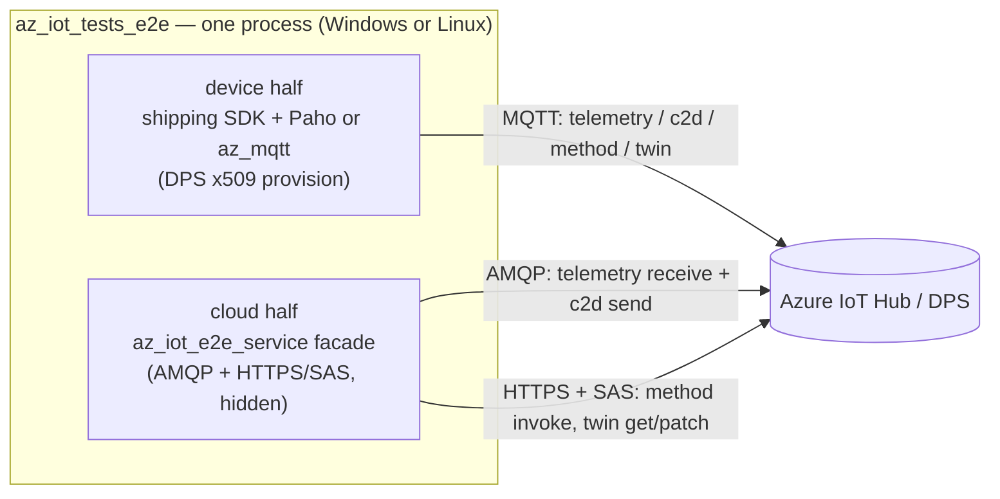

# End-to-end (e2e) tests — C SDK

This document describes the end-to-end test infrastructure for the C SDK
(`c/`). E2E tests validate real scenarios against a **live Azure IoT Hub / DPS**
instance, complementing the in-memory unit tests and the broker-gated
conformance suite.

> Scope: this infrastructure covers the C SDK only. It deliberately reuses the
> same Azure provisioning script that the dotnet CI uses. The service (cloud)
> side of each scenario is a small **in-process C facade** — there is no dotnet
> harness and no subprocess.

---

## Goals & constraints

The infrastructure was designed to satisfy these requirements:

- **SOLID — no flaky tests.** The suite is a real gate (missing cloud resources
  fail loudly, never a silent skip), uses unique per-run correlation markers,
  starts the telemetry watcher *before* the send, and always tears down its
  resource group.
- **As parallel as possible.** The OS matrix legs run concurrently, each in its
  own isolated resource group.
- **Long-running suites out of PRs.** Software updates e2e needs a DPS, ADR namespace and
  Device Update instance linked together, so it runs in its own workflow, not on PRs.
- **Cross-platform.** Every scenario runs on both Windows and Linux hosts, except those in
  [Not run on Windows](#not-run-on-windows).

---

## Architecture

Every scenario runs **in a single process**: one native cmocka test executable
(`az_iot_tests_e2e`) plays *both* halves and drives them cooperatively. There is
no dotnet, no subprocess, and no cross-process handshake.



The test loop interleaves `az_iot_connection_client_do_work` (device) with the
service facade's pump/poll so neither side blocks the other. Everything is
single-threaded and non-blocking.

### Device half — the shipping SDK

The device is the public SDK over an MQTT adapter, connected exactly like a
real device: **DPS provisioning with an X.509 individual enrollment**
(`dps.id_scope` set → the connection client provisions internally, then connects to the assigned hub). Both the MQTT v3.1.1 and v5
factories are registered. Each suite that connects is built once per adapter in the build:
`<suite>` over Paho and `<suite>_az_mqtt` over az_mqtt, selected in the sources with
`AZ_IOT_E2E_ADAPTER_PAHO` or `AZ_IOT_E2E_ADAPTER_AZ_MQTT`. The workflows enable both, and their
`ctest -R` filters run both. The custody suites run over az_mqtt only with OpenSSL TLS. With
az_mqtt, `AZ_IOT_BUILD_E2E_MQTTV5` needs `-DAZ_IOT_AZ_MQTT_SEND_BUFFER_SIZE=1114112` or more: the telemetry size cases publish just
over 1 MiB. The connect flow + all four scenarios live in
[`e2e_scenarios_test.c`](../../tests/e2e/tests/e2e_scenarios_test.c); the connect
is done once for the whole suite via cmocka's group setup.

Device configuration is environment-driven (materialized to files by CI):

| Env var | Meaning |
| --- | --- |
| `AZ_IOT_DPS_ID_SCOPE` | DPS id scope (required) |
| `AZ_IOT_DPS_REGISTRATION_ID` | registration id; also the **device id** the cloud half targets (required) |
| `AZ_IOT_CLIENT_CERT` | path to the device X.509 cert PEM (required) |
| `AZ_IOT_CLIENT_KEY` | path to the device X.509 private key PEM (required) |
| `AZ_IOT_TRUSTED_CA` | path to a CA bundle PEM for TLS server auth (required) |
| `AZ_IOT_DPS_GLOBAL_ENDPOINT` | DPS global endpoint override (optional) |

### Cloud half — the `az_iot_e2e_service` facade

[`az_iot_e2e_service.h`](../../tests/e2e/service/az_iot_e2e_service.h) is a
plain-C facade that lets the test act as the cloud side **without exposing the
transport it uses**. All of the vendored AMQP (`az_amqp`) and HTTPS/SAS machinery
is confined to its implementation and linked **PRIVATE**, so a test translation
unit can never include an AMQP header. This keeps the SDK's MQTT-only device
charter intact: AMQP lives strictly behind this test boundary.

- **Telemetry** (AMQP receive): watches the Event Hub-compatible endpoint.
- **C2D** (AMQP send): sends a cloud-to-device message and awaits acceptance.
- **Direct method / twin** (HTTPS + SAS): a small pumpable HTTP/1.1 client drives
  the IoT Hub REST API so it interleaves with the device's pump.

Service configuration (set by the provisioning config script):

| Env var | Meaning |
| --- | --- |
| `IOTHUB_CONNECTION_STRING` | IoT Hub service policy connection string (c2d / method / twin) |
| `IOTHUB_EVENTHUB_CONNECTION_STRING` | Event Hub-compatible endpoint connection string (telemetry) |
| `IOTHUB_EVENTHUB_LISTEN_NAME` | Event Hub entity name (optional; else from the connection string) |
| `IOTHUB_EVENTHUB_PARTITION_COUNT` | partitions to watch (optional; default 4) |
| `IOTHUB_EVENTHUB_CONSUMER_GROUP` | consumer group to read (optional; default `$Default`) |

The telemetry watcher only receives messages enqueued from 5 minutes before it
starts (an Event Hubs enqueued-time filter), so a reused hub's backlog is skipped.
That window still holds every device's traffic on a shared hub (often hundreds of
messages), so each test starts the watch with a capture filter (its device id or
marker): only bodies containing it enter the watcher's 64-message capture ring, and
other traffic cannot evict a marker the test is about to check.

Concurrent runs share the consumer groups, and Event Hubs detaches a sixth reader of
a partition in a group. When a receiver is detached, the watcher logs
`[e2e] telemetry: the service detached the receiver of partition <n>`, waits 5 s and
reconnects, reading again from the time the watch began. The replayed events are
dropped by their per-partition sequence number, so none is captured twice. The
reconnect closes the socket without waiting, and each `do_work` call advances the
connection setup by at most one step. Setup ends once every receiver's attach is
answered, and fails after 60 s. `az_iot_tests_e2e_amqp_telemetry` covers replay
dropping, the reconnect and the setup deadline against an in-memory Event Hubs
peer, with no live service.

SAS tokens are built with OpenSSL (HMAC-SHA256 + base64) on both platforms. Note
the two key conventions the facade handles: Event Hubs signs with the **raw** key
string, while IoT Hub **base64-decodes** the key first.

### Scenarios

The suite runs four scenarios in one process, each with a unique per-run
correlation marker so a fresh hub never confuses stale data:

1. **telemetry** — the device publishes a marked message; the cloud half observes
   it on the Event Hub endpoint. The watcher starts *before* the send (so nothing
   is missed) and is released afterwards.
2. **c2d** — the cloud sends a marked message; the device's C2D handler receives
   and matches it.
3. **direct method** — the cloud invokes `echo`; the device echoes the payload
   back with `200`; the cloud asserts the status and body.
4. **twin** — the cloud patches a desired property (the device observes it), then
   the device reports a property (the cloud reads it back via a twin GET).

**SAS suites** (every run; a DPS symmetric-key enrollment group, provisioned or
shared; env `AZ_IOT_DPS_SAS_GROUP_KEY`, `AZ_IOT_DPS_SAS_REGISTRATION_ID`,
`AZ_IOT_DPS_ID_SCOPE`, `AZ_IOT_TRUSTED_CA`):

- [`e2e_sas_test.c`](../../tests/e2e/tests/e2e_sas_test.c) — DPS and hub over SAS
  from the group key, then telemetry. `ci-c-e2e`.
- [`e2e_fileupload_test.c`](../../tests/e2e/tests/e2e_fileupload_test.c) — its
  SAS-key scenario uploads a file as `<AZ_IOT_DPS_SAS_REGISTRATION_ID>-fu`.
- [`e2e_csr_sas_test.c`](../../tests/e2e/tests/e2e_csr_sas_test.c) — DPS over SAS
  with a CSR; the hub over the DPS-issued certificate, then telemetry. Also needs
  `AZ_IOT_BUILD_E2E_CSR` (group linked to the signing CA). `ci-c-e2e-csr`.

**TPM suite** (built with every e2e build and run by `ci-c-e2e` on Linux and Windows, on pull
requests and on main; env `AZ_IOT_DPS_ID_SCOPE`, `IOT_DPS_CONNECTION_STRING` (a DPS policy with
EnrollmentWrite and RegistrationStatusWrite), `IOTHUB_CONNECTION_STRING`,
`IOTHUB_EVENTHUB_CONNECTION_STRING`; optional `IOTHUB_REGISTRY_CONNECTION_STRING` (RegistryWrite,
its policy signs the device delete, sent to the `IOTHUB_CONNECTION_STRING` host) and `AZ_IOT_TRUSTED_CA`):

- [`e2e_tpm_test.c`](../../tests/e2e/tests/e2e_tpm_test.c) — a TPM simulated in software
  (`samples/common/sample_tpm_sim.c`) gets a new individual enrollment through the DPS service
  API, registers over HTTPS, connects to the assigned mqttv3 hub with TPM-signed SAS tokens and
  sends telemetry. The enrollment, registration and device are deleted. `ci-c-e2e`.

**mqttv5 suites** (`AZ_IOT_BUILD_E2E_MQTTV5`; DPS assigns the device to an mqttv5 hub):

- [`e2e_mqttv5_custom_topic_test.c`](../../tests/e2e/tests/e2e_mqttv5_custom_topic_test.c) — needs the
  hub's custom topic templates `e2e/{deviceId}/#` and `e2e/shared/#`. Telemetry as a baseline;
  QoS 1 and QoS 0 publishes to those templates reach the events endpoint; a topic no template
  allows and another device's id are refused without disconnecting; a `{deviceId}` template formats
  to the connected id; a topic at exactly 256 bytes or 15 levels is accepted and one past either is
  refused locally (`AZ_IOT_ERR_INVALID_ARG`); several user properties are accepted (body routed).
  `ci-c-e2e-mqttv5`.
  `AZ_IOT_E2E_SKIP_CUSTOM_TOPIC_ROUTING` turns the routed checks into skips when nothing arrives.
- [`e2e_mqttv5_twin_test.c`](../../tests/e2e/tests/e2e_mqttv5_twin_test.c) — desired properties
  patched through the service REST API. Without `twin_push.push_desired`, no change arrives while
  connected and a GET delivers it as a snapshot; with it, the snapshot is pushed on connect and each
  change arrives as a patch. Reported patches are acked with the version the REST twin shows; a
  null member deletes; a stale `if_match`, non-JSON and a 40 KiB patch are refused without losing
  the session. GET returns both sections, or the selected ones, omitting a payload whose version
  `if_not_match` names. `twin_push.push_reported` pushes the reported section on connect; a desired
  change made offline, or before a late handler is set, arrives as a snapshot. A second connection
  with the same identity evicts the session: a GET in flight completes with an error and a desired
  change made during the outage arrives after the automatic reconnect. A 1 ms request timeout
  completes a GET `TIMEOUT`; `AZ_IOT_TWIN_MAX_PENDING` GETs are accepted and the next refused; a
  pushed reported section without a handler is dropped. One connection per test, on one device.
  `ci-c-e2e-mqttv5`.
- [`e2e_mqttv5_connection_test.c`](../../tests/e2e/tests/e2e_mqttv5_connection_test.c) — DPS
  reports the `mqttV5` profile; the saved hub (`iothub_hostname`, `device_id`, `connection_profile`
  with the `dps` fields) connects without DPS and its telemetry reaches the events endpoint; an
  unreachable saved hub and a saved hub declared mqttv3 both end on the mqttv5 hub through DPS;
  three `close()`/`open()` cycles each complete a twin GET; a second connection with the same
  identity evicts the first, which reconnects and sends telemetry and a twin GET. Every state
  transition is printed. `ci-c-e2e-mqttv5`.
- [`e2e_mqttv5_transport_test.c`](../../tests/e2e/tests/e2e_mqttv5_transport_test.c) — DPS and the
  mqttv5 hub over WebSockets (443, default path), over TCP through an HTTP CONNECT proxy, and over
  WebSockets through the proxy, each with a telemetry round trip; the proxy's access log
  (`AZ_IOT_E2E_PROXY_LOG`) must show the CONNECT to DPS, then to the hub. A proxy on a closed port
  keeps the device off the hub and sends nothing, through DPS and on a direct mqttv5 hub connect
  to the assigned hub. Needs `AZ_IOT_PROXY_HOST`/`_PORT`; fails without them. `ci-c-e2e-mqttv5`
  (tinyproxy on Linux; [`eng/e2e-connect-proxy.py`](../../eng/e2e-connect-proxy.py) on Windows,
  which logs the same CONNECT lines).
- [`e2e_mqttv5_direct_method_test.c`](../../tests/e2e/tests/e2e_mqttv5_direct_method_test.c) —
  methods invoked through the service REST API. Answers (200, 500, no payload, a result body of
  exactly `AZ_IOT_MQTTV5_DM_RESULT_BODY_MAX`) reach the caller; undeclared, wrong-case, withdrawn,
  busy and too-short-timeout calls are refused at the probe without running the handler; an
  unanswered call times out and a late answer is not sent; concurrent calls get their own results.
  One connection for the suite. `ci-c-e2e-mqttv5`.
- [`e2e_mqttv5_telemetry_test.c`](../../tests/e2e/tests/e2e_mqttv5_telemetry_test.c) — telemetry
  read back from the events endpoint with its AMQP properties, application properties and
  annotations: routing; `$.ct` / `$.cid` as AMQP content-type / correlation-id; `$.mid`, `$.ce`,
  `$.uid`, `$.ctime`, `$.sub`; custom application properties; eight messages in flight keep their
  order; a 512 KB - 8 KiB body is routed whole and a 1 MiB + 4 KiB body is refused (or the session
  dropped), never routed, and telemetry flows again after. `ci-c-e2e-mqttv5`.
- [`e2e_mqttv5_custody_test.c`](../../tests/e2e/tests/e2e_mqttv5_custody_test.c) — the device key
  inside a SoftHSM2 token (`eng/setup-softhsm.sh`, named by `AZ_IOT_CLIENT_KEY_URI`): DPS and the
  mqttv5 hub accept it, telemetry reaches the events endpoint, and a reconnect loads the key
  reference again. Also needs `AZ_IOT_BUILD_E2E_PKCS11`; fails without the token.
  `ci-c-e2e-mqttv5`.

Direct-hub mode (`AZ_IOT_HUB_HOSTNAME`, `AZ_IOT_DEVICE_ID`) reaches an mqttv5 hub with
`AZ_IOT_HUB_CONNECTION_PROFILE=mqttv5`; without DPS, nothing else reports the hub's profile.

---

## Build & CMake wiring

- CMake option `AZ_IOT_BUILD_E2E` (default **OFF**) in
  [`c/cmake/az_iot_options.cmake`](../../cmake/az_iot_options.cmake).
- [`c/tests/CMakeLists.txt`](../../tests/CMakeLists.txt) adds the `e2e`
  subdirectory when `AZ_IOT_BUILD_E2E` is ON; the configure step fails unless Paho or
  az_mqtt is built (the device half needs a real MQTT adapter).
- [`c/tests/e2e/CMakeLists.txt`](../../tests/e2e/CMakeLists.txt) builds the
  vendored `az_amqp` (under `c/tests/deps/amqp`, test-only), the
  `az_iot_e2e_service` facade, and the `az_iot_tests_e2e` cmocka executable
  (registered with CTest as `az_iot_tests_e2e`, so `ctest -R e2e` selects it).

Build & run locally (needs provisioned Azure + the env vars above):

```pwsh
# from c/  (Windows needs a VS dev shell; Linux needs ninja)
cmake --preset windows-msvc-debug -DAZ_IOT_BUILD_E2E=ON -DAZ_IOT_WITH_PAHO=ON -DAZ_IOT_WITH_AZ_MQTT=ON
cmake --build --preset windows-msvc-debug --config Debug --target az_iot_tests_e2e az_iot_tests_e2e_az_mqtt
ctest --test-dir build/windows-msvc-debug -C Debug -R e2e --output-on-failure
```

---

## CI workflow

[`.github/workflows/ci-c-e2e.yml`](../../../.github/workflows/ci-c-e2e.yml)

### Triggers

- `pull_request` touching `c/**` or `common/**` (fast scenarios)
- `push` to `main`
- nightly `schedule` (cron `0 11 * * *`, 4am PST)
- `workflow_dispatch`

### Authentication

OIDC via `azure/login@v2`, using repo secrets `AZURE_CLIENT_ID`,
`AZURE_TENANT_ID`, `AZURE_SUBSCRIPTION_ID` (same secrets as the dotnet CI). The
job grants `permissions: id-token: write`.

### Provisioning (and guaranteed teardown)

Each job downloads the shared
[`iot-sdks-e2e-fx`](https://github.com/Azure/iot-sdks-e2e-fx) script and:

1. The workflow computes the RG name from the run itself
   (`CSDKE2E<Flavor>-<run_id>-<run_attempt>`, a workflow-level `env`) and passes
   it to the provision action as `rg-name`.
2. `New-AzIotTestEnvironment` → provisions IoT Hub + DPS + enrollments.
3. `New-AzIotCSDKE2ETestConfig -Target powershell` → emits an env-var script
   that is dot-sourced.
4. Materializes the device X.509 material to files (decodes the base64 PEMs and
   builds a CA bundle), maps the DPS config onto the `AZ_IOT_*` vars, then runs
   its group of `e2e` suites.
5. **Always** (`if: always()`) deletes the resource group (`az group delete
   --no-wait`).

The RG name is deliberately *derived from the run* rather than published as a
setup job output: **a cancelled job does not propagate its `outputs`**, so a
teardown reading `needs.setup.outputs.rg` would receive an empty string and
delete nothing while the group stayed behind — which is how superseded
(`cancel-in-progress`) runs used to leak `CSDKE2E*` groups. Because teardown
recomputes the same name, it cleans up even when `setup` is cancelled or times
out; `destroy-e2e-resources` no-ops when the group was never created.

[`cleanup-e2e-resources.yml`](../../../.github/workflows/cleanup-e2e-resources.yml)
is the nightly backstop: it reaps any `CSDKE2E*` (C) or `DotnetE2ETestPipeline-*`
(dotnet) group older than 6 h (via `Remove-LeftoverAzureResourceGroups`),
covering what teardown structurally cannot — an asynchronous `--no-wait` delete
failure, or a runner that dies before teardown.

### Jobs

| Job | Runs on | Purpose |
| --- | --- | --- |
| `setup` | ubuntu | provisions one resource group (IoT Hub + DPS) via the shared `provision-e2e-resources` action and publishes the test-config artifact |
| `test` | ubuntu + windows, 4 groups each (matrix) | builds the e2e tests, materializes its device's X.509 material, and runs its group: `core` (every e2e suite but the three below, plus custody and the file upload sample on Linux), `transport-paho`, `transport-az_mqtt`, `sas` (both adapters) |
| `coverage` | ubuntu | merges the four Linux groups' tracefiles into `coverage-trace-e2e`, only when every `test` job passed |
| `teardown` | ubuntu | `always()` deletes the resource group via `destroy-e2e-resources`, using the run-derived name (not a `setup` output) |

Each `test` job has its own device (index os-index * 4 + group-index; eight DPS
enrollments) and its own Event Hubs consumer group (`e2e-<index>`, created by
`setup`; Event Hubs allows 5 readers per partition per group), so the groups run
in parallel without sharing a device, twin or reader quota.
The `test` jobs share the one resource group provisioned by `setup`, and
`teardown` runs even if a job fails — or if the run is cancelled — so resources
are never leaked.

**Shared environment (temporary, opt-in).** When repository variable
`E2E_SHARED_ID_SCOPE` is set, pull request runs skip `setup`/`teardown` and use a
long-lived IoT Hub + DPS. Each job issues its own device certificate from the DPS
X.509 enrollment group's CA ([`c/eng/e2e-shared-device.ps1`](../../eng/e2e-shared-device.ps1));
the SAS suite registers under the DPS symmetric-key enrollment group. Inputs are repository
secrets `E2E_SHARED_GROUP_CA`, `E2E_SHARED_IOTHUB_CS` and `E2E_SHARED_EVENTHUB_CS`
(`service` policy only), `E2E_SHARED_SAS_GROUP_KEY` (the symmetric-key group's primary
key), and, for the TPM suite, `E2E_SHARED_DPS_CS` (DPS policy with EnrollmentWrite and
RegistrationStatusWrite) and `E2E_SHARED_IOTHUB_REGISTRY_CS` (hub policy with RegistryWrite).
The TPM suite deletes its enrollment and device; other devices the runs register stay in the
shared hub and are removed manually. The hub
needs consumer groups
`e2e-0`..`e2e-9` and file upload with notifications. Push and nightly runs always provision.
Pull requests from forks get no secrets and fail.

[`ci-c-e2e-csr.yml`](../../../.github/workflows/ci-c-e2e-csr.yml) has the same opt-in,
keyed on `E2E_CSR_SHARED_ID_SCOPE`. It needs its own certificate-management environment
(ADR-linked hub and DPS; a DPS without a managed identity cannot be linked), so it
cannot reuse the one above. Each run issues a bootstrap device with
`e2e-shared-device.ps1 -Csr` from secret `E2E_CSR_SHARED_GROUP_CA` (the group's issuing
CA certificate and key, then its root). `E2E_CSR_SHARED_DPS_HOST` optionally sets the DPS
device endpoint. `E2E_CSR_SHARED_SAS_GROUP_KEY` is the key of a symmetric-key group linked
to the same certificate policy.

The shared mqttv5 environment (ADR-linked mqttv5 hub and DPS) is kept usable by
[`ci-c-e2e-mqttv5-adr-namespace.yml`](../../../.github/workflows/ci-c-e2e-mqttv5-adr-namespace.yml)
(every 10 minutes, manual, or `workflow_call` as the first job of a mqttv5 e2e workflow). The ADR namespace
can disappear from ARM, removing its role assignments; DPS registrations then fail.
[`c/eng/e2e-mqttv5-adr-namespace.ps1`](../../eng/e2e-mqttv5-adr-namespace.ps1) re-creates it
(same name, hub region), ensures the 8 role assignments, re-links hub and DPS, and pushes the
namespace to DPS; when the namespace is healthy it makes one ARM read. Inputs are repository
variables `E2E_MQTTV5_SHARED_SUBSCRIPTION_ID`, `_RESOURCE_GROUP`, `_HUB_NAME`, `_DPS_NAME`
and `_ADR_NAMESPACE` (unset `_ADR_NAMESPACE` skips the job); optional `_ADR_API_VERSION`
(default `2026-11-02-preview`) must match the version the namespace was linked with. Optional
`_SU_INSTANCE` names the Software Updates instance (same resource group) to keep linked as
`updating/su-1`: linked by a separate PATCH after hub and DPS, with its 3 role assignments. A rebuild
re-sends existing updating endpoints, and a namespace still in an operation is waited out, not
rebuilt. The OIDC identity needs Contributor
on the resource group. Grant the link's role assignments (hub, DPS and namespace identities) on the
resource group once: those survive the namespace, so the job creates none and needs no role
assignment write unless the namespace identity changes.

[`ci-c-e2e-mqttv5.yml`](../../../.github/workflows/ci-c-e2e-mqttv5.yml) runs the mqttv5 suites on
that environment, one job per client and OS (Linux, and Windows with MSVC: Paho over OpenSSL 4.1.0,
az_mqtt over Schannel; custody is Linux only, see [Not run on Windows](#not-run-on-windows)), each
with its own device. The twin, transport and custom topic suites run one job per
adapter and per shard instead (`AZ_IOT_TEST_SHARD=<index>/<count>`, see
[`test_shard.h`](../../tests/support/test_shard.h)), each with its own device, so their cases run in
parallel. On schedule and manual runs the namespace job runs first; pull
requests skip it (it logs in to Azure and runs the checked-out script) and rely on its scheduled run (every 10 minutes). Each job issues a device with
`e2e-shared-device.ps1 -Prefix E2E_MQTTV5_SHARED` from secret `E2E_MQTTV5_SHARED_GROUP_CA`, and
reads secrets `E2E_MQTTV5_SHARED_IOTHUB_SERVICE_CS` and `_EVENTHUB_CS` (`service` policy; the former is passed to the
script as `E2E_MQTTV5_SHARED_IOTHUB_CS`, as the secret of that name holds `iothubowner` for the .NET e2e), and variables `E2E_MQTTV5_SHARED_ID_SCOPE` (unset skips the workflow) and
`_DPS_HOST`. No SAS: mqttv5 hubs accept X.509 only. Triggers: pull requests touching mqttv5 or core device code, the e2e harness or the
workflow; nightly; manual. Pull requests from forks and from Dependabot skip.

> **Software updates e2e** runs in its own workflow
> ([`ci-c-e2e-adu.yml`](../../../.github/workflows/ci-c-e2e-adu.yml), Linux) on the same shared mqttv5
> environment and triggers. See [Software updates e2e](#software-updates-e2e).

---

## Software updates e2e

Two suites, built with `-DAZ_IOT_BUILD_E2E_SU=ON` and selected by
`ctest -R e2e_su`. Both run the shipping SDK over each MQTT adapter (Paho, az_mqtt) and X.509 against
the real service.

| Suite | What it drives |
| --- | --- |
| `az_iot_tests_e2e_su` (`e2e_su_test.c`) | The DPS channel with no update offered: onboarding check, hold release and registration, ETag storage, unknown-workflow report. |
| `az_iot_tests_e2e_su_offer` (`e2e_su_offer_test.c`) | Offered updates through `az_iot_su_client`: OpenSSL crypto, Microsoft plus test root keys, real download (libcurl) and hash; install/apply recorded, failures injected. A spy around the channel records each report and the service's verdict. |

Offered-update scenarios:

| Scenario | Offer |
| --- | --- |
| real update downloaded, verified, installed, reported SUCCEEDED | `AZ_IOT_E2E_SU_OFFER_MODEL` |
| identical terminal report accepted; conflicting one gets 409000 `REPORT_CONFLICT` | same |
| incompatible device offered nothing | none |
| install failure rolled back, reported FAILED | `AZ_IOT_E2E_SU_OFFER_MODEL_INSTALL_FAILURE` |
| already installed, reported SKIPPED | `AZ_IOT_E2E_SU_OFFER_MODEL_ALREADY_INSTALLED` |
| manifest verified against the wrong keys, reported FAILED | `AZ_IOT_E2E_SU_OFFER_MODEL_UNTRUSTED` |
| library mode: verified offer handed to the application, which downloads, hashes and reports progress then SUCCEEDED | `AZ_IOT_E2E_SU_OFFER_MODEL_LIBRARY_MODE` |

The device identity is fixed by its certificate, so offers are told apart by compatibility:
each is an update compatible only with `AZ_IOT_E2E_SU_OFFER_MANUFACTURER` and its model, with
its own Azure Device Registry `OnboardingUpdate` job. A job offers nothing until it has a run, so
each gets one run that starts at once; staging waits until every run is `Active`, then 5 more
minutes (devices got `401000` for about 3 minutes after a run turned `Active`). An onboarding offer
reaches a device once: a device that reported it is not offered it again, so every execution of the
offer suite (one per MQTT adapter) needs its own new device.
[`scripts/SuE2E.psm1`](../../tests/e2e/scripts/SuE2E.psm1) stages them (`New-SuE2EOffers`),
checks each job's per-device result (`Test-SuE2EOffers`) and deletes them
(`Remove-SuE2EOffers`). Since each offer reaches each new device, one staged set can serve many
runs: `New-SuE2EOffers -Reuse` keeps the updates, jobs and `Active` runs that already exist under
its `-RunId`, and only waits for runs it creates (or for what is left of the 5 minutes of a kept run
started less than 5 minutes ago). A reused job may hold several runs, so `Test-SuE2EOffers` looks for
the device in every `Active` run, then in the newest. `Export-SuE2EOfferVariables` sets the offer
variables for a `-RunId` without contacting Azure. `Get-SuE2EFixtureTag` hashes the code that defines the offers;
appended to a reused `-RunId`, a change to that code stages a new set. With `-Reuse`, a failed import
is treated as done if the update now exists (another run imported it), else retried up to 3 times.
Each REST request is retried on a transient failure (no response; HTTP 408, 429, 500, 502, 503 or
504; another 5xx with a transient error code such as `BadGatewayConnection`), up to 5 attempts,
after `Retry-After` or 2, 4, 8, 16 s (at most 60 s), with a warning per retry; a `401` with
`invalid_token` is retried once with a new token, and other `4xx` are not retried.

CI ([`ci-c-e2e-adu.yml`](../../../.github/workflows/ci-c-e2e-adu.yml)) runs on the shared mqttv5
environment, whose ADR namespace is linked to a Device Update instance, on pull requests touching
core, Software Update or adapter code, the e2e harness or the workflow; nightly; manual. Pull requests
from forks and from Dependabot skip. Scheduled and manual runs first run the namespace repair
(`ci-c-e2e-mqttv5-adr-namespace.yml`), which also restores the Software Update link. One job then
ensures the standing offers (`New-SuE2EOffers -RunId "s$(Get-SuE2EFixtureTag)" -Reuse`; seconds once
staged), issues a new device per suite execution (4: each suite on each adapter) from the enrollment
group's CA (`e2e-shared-device.ps1`), runs the suites, then checks the offer devices' job results.
Nothing is deleted per run; offer sets staged by older fixture code are left in place. Inputs:
variables `E2E_MQTTV5_SHARED_SUBSCRIPTION_ID`, `_RESOURCE_GROUP`, `_ADR_NAMESPACE`, `_ID_SCOPE`,
`_DPS_HOST`, `_LOCATION`, `_SU_ENDPOINT`, `_SU_STORAGE_ACCOUNT`, `_SU_STORAGE_CONTAINER`, and
`_SU_INSTANCE` (the Device Update instance the namespace repair links); secrets `E2E_MQTTV5_SHARED_GROUP_CA`,
`_IOTHUB_SERVICE_CS`, `_EVENTHUB_CS`, `AZURE_CLIENT_ID`, `AZURE_TENANT_ID`.

Every variable is required; a missing one fails the suite or the scenario that needs it.

| Env var | Meaning |
| --- | --- |
| `AZ_IOT_E2E_SU_DPS_HOST` | DPS global endpoint |
| `AZ_IOT_E2E_SU_ID_SCOPE` | DPS id scope |
| `AZ_IOT_E2E_SU_REG_ID` | registration id the certificate carries |
| `AZ_IOT_E2E_SU_CERT` / `_KEY` | device certificate and key PEM paths |
| `AZ_IOT_E2E_SU_TRUSTED_CA` | CA bundle PEM path |
| `AZ_IOT_E2E_SU_OFFER_*` | offers, as above (set by `New-SuE2EOffers` or `Export-SuE2EOfferVariables`) |

`https_proxy`, when set, is used for the MQTT connection; libcurl reads it as well.

Test root keys are pinned in `e2e_su_test_roots.c`. Not yet covered: the operational route,
multi-step updates, and reboot/resume.

---

## Not run on Windows

Every other e2e suite runs on Linux and on Windows (MSVC; Paho over OpenSSL 4.1.0, az_mqtt over
Schannel), on every pull request and main run of its workflow.

| Suite | Why |
| --- | --- |
| `az_iot_tests_e2e_custody`, `az_iot_tests_e2e_mqttv5_custody` | The device key is in a PKCS#11 token (SoftHSM2) reached through the OpenSSL pkcs11 provider. The provider has no MSVC build (it needs a POSIX `dl` library) and the runner's OpenSSL is an MSVC build. az_mqtt on Windows uses Schannel, which takes no key references. |
| `az_iot_tests_e2e_amqp_transport_sigpipe` | Tests SIGPIPE, which Windows does not have. |
| `az_iot_tests_e2e_csr`, `az_iot_tests_e2e_csr_sas` (`ci-c-e2e-csr`) | Not wired up on Windows yet. |
| `az_iot_tests_e2e_su`, `az_iot_tests_e2e_su_offer` (`ci-c-e2e-adu`) | Not built on Windows yet. |

---

## Conventions & gotchas

- **Always a real gate, never a skip.** The suite connects the device and
  creates the service facade in cmocka's group setup; if any prerequisite (env
  var, cloud resource, device connect) is missing, group setup returns non-zero
  and the whole suite **fails** with an actionable message. These tests run only
  against real Azure resources (the ci-c-e2e pipeline, or a deliberate local run
  with the e2e-fx config dot-sourced), so there is no "skipped but green" path to
  hide a broken setup.
- **CA bundle without downloads.** [`eng/e2e-trusted-ca.ps1`](../../eng/e2e-trusted-ca.ps1)
  writes it: the OpenSSL system bundle on Linux, the `Root` stores on Windows. Avoid
  fetching roots over the network.
- **TLS state per connection.** The vendored reference transport keeps each
  connection's TLS state (Schannel on Windows, OpenSSL on Linux) in its own
  storage, so service connections can be open at the same time.
- **Resource quotas are hard limits.** Provisioning per matrix leg keeps tests
  isolated but multiplies resource usage; keep the matrix lean and always delete
  the RG.
- **Seconds-scale defensive timeouts.** Every client that can open an mqttv5
  session (`e2e_device.c`, both custody suites) calls
  `e2e_use_short_defensive_timeouts()` (`tests/e2e_defensive_timeout.h`): the
  birth-ack schedule becomes 5/6/8/10 s + 0-5 s jitter instead of minutes, so a
  missed birth-ack recovers inside the connect windows. It uses the internal
  `az_iot_connection_client__set_defensive_timeout_schedule()`; clients that
  do not call it keep the spec's schedule.
- **HTTPS calls without a response are retried when safe.** A connection can
  stall with no response at all. The service facade sends a request again on a
  new connection (3 attempts, 2 s apart) when none of it was sent, or when it is
  idempotent (the DPS and device DELETEs, and the twin GET and desired PATCH;
  20 s per attempt instead of 60 s). This holds for the blocking calls and for
  those driven with `az_iot_e2e_service_request_poll()`, which pause without
  blocking. Each failed attempt is logged with its phase, bytes sent and
  received, and the transport's error.
- **DPS provisioning has its own time budget.** DPS assignment intermittently
  takes from tens of seconds to over 90 s. Connect waits charge time to DPS
  while the client's DPS scope is active, with a budget of 180 s
  (`tests/e2e_connect_clock.h`), and to the hub otherwise, with the suite's
  connect timeout. Each connect logs both times.

---

## Adding a new scenario

1. **Device side:** in [`e2e_scenarios_test.c`](../../tests/e2e/tests/e2e_scenarios_test.c)
   add a `test_*` function and register it with
   `cmocka_unit_test_teardown(test_*, detach_feature_client)`. Reuse the
   already-connected device from the shared fixture; interleave
   `az_iot_connection_client_do_work` with the service pump until the assertion
   holds or a bounded deadline expires. Attach the test's one feature client in
   the fixture's `client` union and set `attached` to its kind: a failed
   assertion leaves the test early, and the teardown must deinitialize it, or
   the shared connection keeps pointers into the failed test's stack. A
   callback context the SDK may call after that `deinit` (a telemetry send's)
   belongs in the fixture too.
2. **Service side:** if the scenario needs a new cloud operation, add it to the
   [`az_iot_e2e_service`](../../tests/e2e/service/az_iot_e2e_service.h) facade
   (keep all `az_amqp` / HTTP usage inside the `service/*.c` files so tests stay
   transport-agnostic).
3. **Distinct devices for parallelism:** the config generator currently emits a
   single DPS x509 individual enrollment. To run scenarios against different
   devices, provision more via
   `New-AzIotTestEnvironment -DpsX509IndividualEnrollments <N>` and thread the
   extra registration ids/material through.
