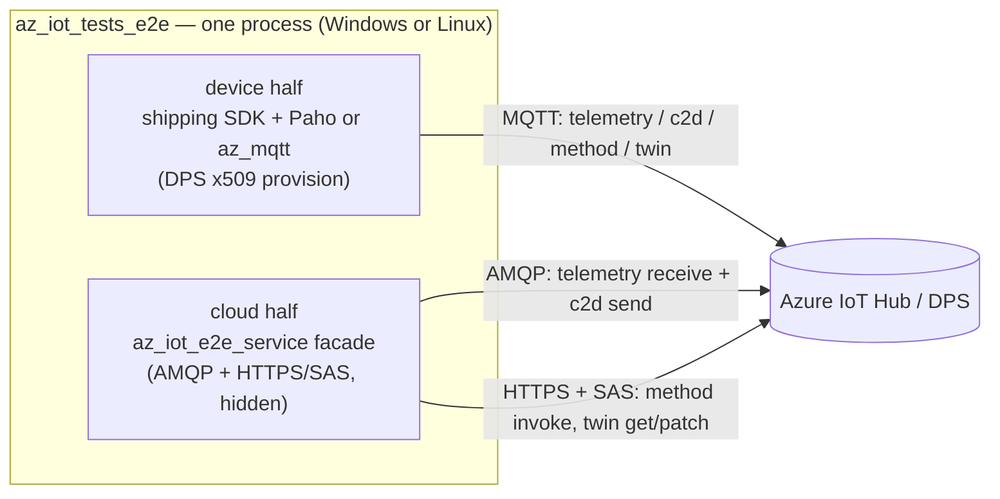

# End-to-end (e2e) tests — C SDK

This document describes the end-to-end test infrastructure for the C SDK
(`c/`). E2E tests validate real scenarios against a **live Azure IoT Hub / DPS**
instance, complementing the in-memory unit tests and the broker-gated
conformance suite.

> Scope: this infrastructure covers the C SDK only. It deliberately reuses the
> same Azure provisioning script that the dotnet CI uses. The service (cloud)
> side of each scenario is a small **in-process C facade** — there is no dotnet
> harness and no subprocess.

---

## Goals & constraints

The infrastructure was designed to satisfy these requirements:

- **SOLID — no flaky tests.** The suite is a real gate (missing cloud resources
  fail loudly, never a silent skip), uses unique per-run correlation markers,
  starts the telemetry watcher *before* the send, and always tears down its
  resource group.
- **As parallel as possible.** The OS matrix legs run concurrently, each in its
  own isolated resource group.
- **Cross-platform.** Every scenario runs on both Windows and Linux hosts, except those in
  [Not run on Windows](#not-run-on-windows).

---

## Architecture

Every scenario runs **in a single process**: one native cmocka test executable
(`az_iot_tests_e2e`) plays *both* halves and drives them cooperatively. There is
no dotnet, no subprocess, and no cross-process handshake.



The test loop interleaves `az_iot_connection_client_do_work` (device) with the
service facade's pump/poll so neither side blocks the other. Everything is
single-threaded and non-blocking.

### Device half — the shipping SDK

The device is the public SDK over an MQTT adapter, connected exactly like a
real device: **DPS provisioning with an X.509 individual enrollment**
(`dps.id_scope` set → the connection client provisions internally, then connects to the assigned hub). The connection
client builds its MQTT 3.1.1 clients with the adapter's descriptor (`mqtt_adapter`) in a heap workspace, sized in
[`e2e_mqtt_adapter.h`](../../tests/e2e/tests/e2e_mqtt_adapter.h). Each suite that connects is built once per adapter in the build:
`<suite>` over Paho and `<suite>_az_mqtt` over az_mqtt, selected in the sources with
`AZ_IOT_E2E_ADAPTER_PAHO` or `AZ_IOT_E2E_ADAPTER_AZ_MQTT`. The workflows enable both, and their
`ctest -R` filters run both. The custody suites run over az_mqtt only with OpenSSL TLS. The send
buffer in those sizes is 1 MiB + 64 KiB: the telemetry size cases publish 1 MiB + 4 KiB, plus MQTT headers. The connect flow + all four scenarios live in
[`e2e_scenarios_test.c`](../../tests/e2e/tests/e2e_scenarios_test.c); the connect
is done once for the whole suite via cmocka's group setup.

Device configuration is environment-driven (materialized to files by CI):

| Env var | Meaning |
| --- | --- |
| `AZ_IOT_DPS_ID_SCOPE` | DPS id scope (required) |
| `AZ_IOT_DPS_REGISTRATION_ID` | registration id; also the **device id** the cloud half targets (required) |
| `AZ_IOT_CLIENT_CERT` | path to the device X.509 cert PEM (required) |
| `AZ_IOT_CLIENT_KEY` | path to the device X.509 private key PEM (required) |
| `AZ_IOT_TRUSTED_CA` | path to a CA bundle PEM for TLS server auth (required) |
| `AZ_IOT_DPS_GLOBAL_ENDPOINT` | DPS global endpoint override (optional) |

### Cloud half — the `az_iot_e2e_service` facade

[`az_iot_e2e_service.h`](../../tests/e2e/service/az_iot_e2e_service.h) is a
plain-C facade that lets the test act as the cloud side **without exposing the
transport it uses**. All of the vendored AMQP (`az_amqp`) and HTTPS/SAS machinery
is confined to its implementation and linked **PRIVATE**, so a test translation
unit can never include an AMQP header. This keeps the SDK's MQTT-only device
charter intact: AMQP lives strictly behind this test boundary.

- **Telemetry** (AMQP receive): watches the Event Hub-compatible endpoint.
- **C2D** (AMQP send): sends a cloud-to-device message and awaits acceptance.
- **Direct method / twin** (HTTPS + SAS): a small pumpable HTTP/1.1 client drives
  the IoT Hub REST API so it interleaves with the device's pump.

Service configuration (set by the provisioning config script):

| Env var | Meaning |
| --- | --- |
| `IOTHUB_CONNECTION_STRING` | IoT Hub service policy connection string (c2d / method / twin) |
| `IOTHUB_EVENTHUB_CONNECTION_STRING` | Event Hub-compatible endpoint connection string (telemetry) |
| `IOTHUB_EVENTHUB_LISTEN_NAME` | Event Hub entity name (optional; else from the connection string) |
| `IOTHUB_EVENTHUB_PARTITION_COUNT` | partitions to watch (optional; default 4) |
| `IOTHUB_EVENTHUB_CONSUMER_GROUP` | consumer group to read (optional; default `$Default`) |

The telemetry watcher only receives messages enqueued from 5 minutes before it
starts (an Event Hubs enqueued-time filter), so a reused hub's backlog is skipped.
That window still holds every device's traffic on a shared hub (often hundreds of
messages), so each test starts the watch with a capture filter (its device id or
marker): only bodies containing it enter the watcher's 64-message capture ring, and
other traffic cannot evict a marker the test is about to check.

Concurrent runs share the consumer groups, and Event Hubs detaches a sixth reader of
a partition in a group. When a receiver is detached, the watcher logs
`[e2e] telemetry: the service detached the receiver of partition <n>`, waits 5 s and
reconnects, reading again from the time the watch began. The replayed events are
dropped by their per-partition sequence number, so none is captured twice. The
reconnect closes the socket without waiting, and each `do_work` call advances the
connection setup by at most one step. Setup ends once every receiver's attach is
answered, and fails after 60 s. `az_iot_tests_e2e_amqp_telemetry` covers replay
dropping, the reconnect and the setup deadline against an in-memory Event Hubs
peer, with no live service.

SAS tokens are built with OpenSSL (HMAC-SHA256 + base64) on both platforms. Note
the two key conventions the facade handles: Event Hubs signs with the **raw** key
string, while IoT Hub **base64-decodes** the key first.

### Scenarios

The suite runs four scenarios in one process, each with a unique per-run
correlation marker so a fresh hub never confuses stale data:

1. **telemetry** — the device publishes a marked message; the cloud half observes
   it on the Event Hub endpoint. The watcher starts *before* the send (so nothing
   is missed) and is released afterwards.
2. **c2d** — the cloud sends a marked message; the device's C2D handler receives
   and matches it.
3. **direct method** — the cloud invokes `echo`; the device echoes the payload
   back with `200`; the cloud asserts the status and body.
4. **twin** — the cloud patches a desired property (the device observes it), then
   the device reports a property (the cloud reads it back via a twin GET).

**SAS suites** (every run; a DPS symmetric-key enrollment group, provisioned or
shared; env `AZ_IOT_DPS_SAS_GROUP_KEY`, `AZ_IOT_DPS_SAS_REGISTRATION_ID`,
`AZ_IOT_DPS_ID_SCOPE`, `AZ_IOT_TRUSTED_CA`):

- [`e2e_sas_test.c`](../../tests/e2e/tests/e2e_sas_test.c) — DPS and hub over SAS
  from the group key, then telemetry. `ci-c-e2e`.
- [`e2e_fileupload_test.c`](../../tests/e2e/tests/e2e_fileupload_test.c) — its
  SAS-key scenario uploads a file as `<AZ_IOT_DPS_SAS_REGISTRATION_ID>-fu`.
- [`e2e_csr_sas_test.c`](../../tests/e2e/tests/e2e_csr_sas_test.c) — DPS over SAS
  with a CSR; the hub over the DPS-issued certificate, then telemetry. Also needs
  `AZ_IOT_BUILD_E2E_CSR` (group linked to the signing CA). `ci-c-e2e-csr`.

**TPM suite** (built with every e2e build and run by `ci-c-e2e` on Linux and Windows, on pull
requests and on main; env `AZ_IOT_DPS_ID_SCOPE`, `IOT_DPS_CONNECTION_STRING` (a DPS policy with
EnrollmentWrite and RegistrationStatusWrite), `IOTHUB_CONNECTION_STRING`,
`IOTHUB_EVENTHUB_CONNECTION_STRING`; optional `IOTHUB_REGISTRY_CONNECTION_STRING` (RegistryWrite,
its policy signs the device delete, sent to the `IOTHUB_CONNECTION_STRING` host) and `AZ_IOT_TRUSTED_CA`):

- [`e2e_tpm_test.c`](../../tests/e2e/tests/e2e_tpm_test.c) — a TPM simulated in software
  (`samples/common/sample_tpm_sim.c`) gets a new individual enrollment through the DPS service
  API, registers over HTTPS, connects to the assigned mqttv3 hub with TPM-signed SAS tokens and
  sends telemetry. It then deletes the device and its enrollment, expects the hub to refuse the
  identity, enrolls it again under a new device ID, registers again and sends again. The enrollment, registration and device are deleted.
  `ci-c-e2e`.

---

## Build & CMake wiring

- CMake option `AZ_IOT_BUILD_E2E` (default **OFF**) in
  [`c/cmake/az_iot_options.cmake`](../../cmake/az_iot_options.cmake).
- [`c/tests/CMakeLists.txt`](../../tests/CMakeLists.txt) adds the `e2e`
  subdirectory when `AZ_IOT_BUILD_E2E` is ON; the configure step fails unless Paho or
  az_mqtt is built (the device half needs a real MQTT adapter).
- [`c/tests/e2e/CMakeLists.txt`](../../tests/e2e/CMakeLists.txt) builds the
  vendored `az_amqp` (under `c/tests/deps/amqp`, test-only), the
  `az_iot_e2e_service` facade, and the `az_iot_tests_e2e` cmocka executable
  (registered with CTest as `az_iot_tests_e2e`, so `ctest -R e2e` selects it).

Build & run locally (needs provisioned Azure + the env vars above):

```pwsh
# from c/  (Windows needs a VS dev shell; Linux needs ninja)
cmake --preset windows-msvc-debug -DAZ_IOT_BUILD_E2E=ON -DAZ_IOT_WITH_PAHO=ON -DAZ_IOT_WITH_AZ_MQTT=ON
cmake --build --preset windows-msvc-debug --config Debug --target az_iot_tests_e2e az_iot_tests_e2e_az_mqtt
ctest --test-dir build/windows-msvc-debug -C Debug -R e2e --output-on-failure
```

---

## CI workflow

[`.github/workflows/ci-c-e2e.yml`](../../../.github/workflows/ci-c-e2e.yml)

### Triggers

- `pull_request`: every pull request; a `changes` job skips the e2e legs unless it touches `c/**` or
  `common/**` (fast scenarios)
- `push` to `main` and `releases/public-preview`
- nightly `schedule` (cron `0 11 * * *`, 4am PST); on `releases/public-preview` at 14:00 UTC, dispatched by
  [`ci-c-public-preview-nightly.yml`](../../../.github/workflows/ci-c-public-preview-nightly.yml)
- `workflow_dispatch`

Every C e2e workflow ends with a `<workflow>-gate` job (`ci-c-e2e-gate`, `ci-c-e2e-csr-gate`,
`ci-c-e2e-mqttv5-gate`, `ci-c-e2e-adu-gate`), the single check name for rulesets to require. Since its
workflow runs on every pull request (`ci-c-e2e-mqttv5` and `ci-c-e2e-adu`: every pull request to
`releases/public-preview`), it always reports; it fails only when a job failed or was
cancelled. The other C workflows end with `ci-c-gate`, `ci-c-static-analysis-gate`, `codeql-c-gate`
and `ci-c-yocto-gate`.

### Authentication

OIDC via `azure/login@v2`, using repo secrets `AZURE_CLIENT_ID`,
`AZURE_TENANT_ID`, `AZURE_SUBSCRIPTION_ID` (same secrets as the dotnet CI). The
job grants `permissions: id-token: write`.

### Provisioning (and guaranteed teardown)

Each job downloads the shared
[`iot-sdks-e2e-fx`](https://github.com/Azure/iot-sdks-e2e-fx) script and:

1. The workflow computes the RG name from the run itself
   (`CSDKE2E<Flavor>-<run_id>-<run_attempt>`, a workflow-level `env`) and passes
   it to the provision action as `rg-name`.
2. `New-AzIotTestEnvironment` → provisions IoT Hub + DPS + enrollments.
3. `New-AzIotCSDKE2ETestConfig -Target powershell` → emits an env-var script
   that is dot-sourced.
4. Materializes the device X.509 material to files (decodes the base64 PEMs and
   builds a CA bundle), maps the DPS config onto the `AZ_IOT_*` vars, then runs
   its group of `e2e` suites.
5. **Always** (`if: always()`) deletes the resource group (`az group delete
   --no-wait`).

The RG name is deliberately *derived from the run* rather than published as a
setup job output: **a cancelled job does not propagate its `outputs`**, so a
teardown reading `needs.setup.outputs.rg` would receive an empty string and
delete nothing while the group stayed behind — which is how superseded
(`cancel-in-progress`) runs used to leak `CSDKE2E*` groups. Because teardown
recomputes the same name, it cleans up even when `setup` is cancelled or times
out; `destroy-e2e-resources` no-ops when the group was never created.

[`cleanup-e2e-resources.yml`](../../../.github/workflows/cleanup-e2e-resources.yml)
is the nightly backstop: it reaps any `CSDKE2E*` (C), `DotnetE2ETestPipeline-*`
(dotnet) or `DotnetLonghaul-*` (dotnet longhaul) group older than 8 h (via
`Remove-LeftoverAzureResourceGroups`),
covering what teardown structurally cannot — an asynchronous `--no-wait` delete
failure, or a runner that dies before teardown.

### Jobs

| Job | Runs on | Purpose |
| --- | --- | --- |
| `setup` | ubuntu | provisions one resource group (IoT Hub + DPS) via the shared `provision-e2e-resources` action and publishes the test-config artifact |
| `test` | ubuntu + windows, 4 groups each (matrix) | builds the e2e tests, materializes its device's X.509 material, and runs its group: `core` (every e2e suite but the three below, plus custody on Linux), `transport-paho`, `transport-az_mqtt`, `sas` (both adapters) |
| `coverage` | ubuntu | merges the four Linux groups' tracefiles into `coverage-trace-e2e`, only when every `test` job passed |
| `esp32-qemu` | ubuntu, esp32, esp32c3 and esp32s3 (matrix) | the ESP32 IoT Hub sample in QEMU, always on the shared environment ([ESP32 in QEMU](#esp32-in-qemu)) |
| `teardown` | ubuntu | `always()` deletes the resource group via `destroy-e2e-resources`, using the run-derived name (not a `setup` output) |

Each `test` job has its own device (index os-index * 4 + group-index; eight DPS
enrollments) and its own Event Hubs consumer group (`e2e-<index>`, created by
`setup`; Event Hubs allows 5 readers per partition per group), so the groups run
in parallel without sharing a device, twin or reader quota.
The `test` jobs share the one resource group provisioned by `setup`, and
`teardown` runs even if a job fails — or if the run is cancelled — so resources
are never leaked.

**Shared environment (temporary, opt-in).** When repository variable
`E2E_SHARED_ID_SCOPE` is set, pull request runs skip `setup`/`teardown` and use a
long-lived IoT Hub + DPS. Each job issues its own device certificate from the DPS
X.509 enrollment group's CA ([`c/eng/e2e-shared-device.ps1`](../../eng/e2e-shared-device.ps1));
the SAS suite registers under the DPS symmetric-key enrollment group. Inputs are repository
secrets `E2E_SHARED_GROUP_CA`, `E2E_SHARED_IOTHUB_CS` and `E2E_SHARED_EVENTHUB_CS`
(`service` policy only), `E2E_SHARED_SAS_GROUP_KEY` (the symmetric-key group's primary
key), and, for the TPM suite, `E2E_SHARED_DPS_CS` (DPS policy with EnrollmentWrite and
RegistrationStatusWrite) and `E2E_SHARED_IOTHUB_REGISTRY_CS` (hub policy with RegistryWrite).
The TPM suite deletes its enrollment and device; other devices the runs register stay in the
shared hub and are removed manually. The hub
needs consumer groups
`e2e-0`..`e2e-9` and file upload with notifications. Push and nightly runs always provision,
except for `esp32-qemu`, which always uses the shared environment.
Pull requests from forks get no secrets and fail.

[`ci-c-e2e-csr.yml`](../../../.github/workflows/ci-c-e2e-csr.yml) has the same opt-in,
keyed on `E2E_CSR_SHARED_ID_SCOPE`. It needs its own certificate-management environment
(ADR-linked hub and DPS; a DPS without a managed identity cannot be linked), so it
cannot reuse the one above. Each run issues a bootstrap device with
`e2e-shared-device.ps1 -Csr` from secret `E2E_CSR_SHARED_GROUP_CA` (the group's issuing
CA certificate and key, then its root); its Linux and Windows legs each issue their own. A
provisioned run has one bootstrap device, so its legs run one after the other. `E2E_CSR_SHARED_DPS_HOST` optionally sets the DPS
device endpoint. `E2E_CSR_SHARED_SAS_GROUP_KEY` is the key of a symmetric-key group linked
to the same certificate policy.

`ci-c-e2e-mqttv5.yml` and `ci-c-e2e-mqttv5-adr-namespace.yml` serve `releases/public-preview` only.

---

## ESP32 in QEMU

[`e2e_esp32_qemu_test.c`](../../tests/e2e/tests/e2e_esp32_qemu_test.c)
(`az_iot_tests_e2e_esp32_qemu`, `-DAZ_IOT_BUILD_E2E_ESP32_QEMU=ON`, POSIX hosts) plays only
the service. The device is the [ESP32 IoT Hub sample](../../samples/unified/esp32/README.md)
firmware in Espressif's QEMU. The test starts it with `E2E_ESP32_QEMU_COMMAND` (through
`/bin/sh -c`, in its own process group) and reads the sample's stable `hub_esp32:` log lines.
It runs the firmware through the child-process helper below.
`E2E_ESP32_DEVICE_ID` is the registration id the firmware was built with. Once the firmware
logs `hub_esp32: ready on`:

1. **telemetry** — `{"deviceId":"<id>",...}` reaches the Event Hub endpoint;
2. **direct method** — `echo` answers `200` with its marked payload;
3. **twin** — the test patches a marked desired property; the firmware logs
   `desired version <v> acknowledged` and a twin GET shows `"desiredVersion":<v>` in reported.

[`eng/esp-idf-qemu-e2e.sh`](../../eng/esp-idf-qemu-e2e.sh) `<target> <cert.pem> <key.pem>`
runs it all in an ESP-IDF environment with QEMU, a host compiler and OpenSSL headers:

1. builds the sample's `qemu` firmware with the device's DPS settings (`SDKCONFIG_EXTRA`
   for [`eng/esp-idf-build.sh`](../../eng/esp-idf-build.sh));
2. writes the identity with [`eng/esp-idf-qemu-identity.sh`](../../eng/esp-idf-qemu-identity.sh):
   - esp32: an `esp_secure_cert` partition holding the certificate and key;
   - esp32c3 and esp32s3: the key goes into the Digital Signature peripheral. The script boots
     QEMU in download mode, and `configure_esp_secure_cert.py --configure_ds` burns the DS key
     into an emulated eFuse image and writes the partition with the encrypted DS parameters. The
     esp32c3 DS takes RSA keys of at most 3072 bits;
3. builds and runs the test, booting the firmware with
   [`eng/esp-idf-qemu.sh`](../../eng/esp-idf-qemu.sh) `--run`.

CI: job `esp32-qemu` in `ci-c-e2e.yml`. It runs esp32, esp32c3 and esp32s3 in
`espressif/idf:v6.1`, with devices 12, 13 and 14 issued by `e2e-shared-device.ps1`. It uses the
shared environment on every run, push and nightly included: the per-run enrollments' RSA-4096 keys
exceed the esp32c3 DS's 3072 bits, while the shared group CA issues RSA-2048. Without the shared
environment's secrets, the job fails.

### Child-process helper

[`tests/support/e2e_process.h`](../../tests/support/e2e_process.h) runs a program as a child, on
POSIX and Windows, for suites whose device is another process: it starts an argument list or a
shell command (environment variables set or removed for the child only), captures stdout and stderr through
one pipe, echoes whole lines with a prefix, waits for a text while calling a pump (here the
service facade), and stops the child: SIGTERM to its process group (Windows: `CTRL_BREAK_EVENT`
to its process group), then SIGKILL (Windows: its job object is terminated) after a grace period.
It is built in every build, not only with `AZ_IOT_BUILD_E2E`, and its test,
`az_iot_tests_e2e_process`, runs in `ci-c`'s unit-test ctest on Linux and Windows.

---

## Samples

[`e2e_samples_test.c`](../../tests/e2e/tests/e2e_samples_test.c) runs each connecting sample
against the mqttv3 hub and checks its work from the service side. CMake option
`AZ_IOT_BUILD_E2E_SAMPLES` (needs `AZ_IOT_BUILD_E2E`, `AZ_IOT_BUILD_SAMPLES` and
`AZ_IOT_BUILD_SAMPLES_WITH_PIPELINE_HOOKS`) registers one CTest test per sample and adapter,
`az_iot_samples_e2e_<group>_<name>_<adapter>`, labelled `samples_mqttv3`. A sample in scope that is
not built fails the configure.

Each test:

1. gives the sample only the variables it reads (its README): the leg's X.509 device, or a
   registration ID of its own (`<leg registration ID>-<suffix>`), and a work directory. The
   service connection strings are removed from its environment;
2. starts it, lets it run to its own end (unified samples 60 s; the one-shot samples their own
   timeouts), and stops it only past the test's own limit;
3. requires `sample-pipeline: end rc=0` and exit code 0, then the check below.

| Sample | Check |
| --- | --- |
| `unified/telemetry`, `connect_first`, `websockets`, `multithreaded_telemetry` | Telemetry of that device reaches the Event Hub endpoint, enqueued after the test started (the watcher filters on `iothub-connection-device-id`). |
| `unified/proxy` | Same, and the proxy's log shows a `CONNECT` to port 8883 ([proxy.py](https://github.com/abhinavsingh/proxy.py), log in `AZ_IOT_SAMPLES_E2E_PROXY_LOG`). |
| `unified/twin_get_patch` | A twin GET shows reported `sample` = `hello`, `$lastUpdated` after the start. |
| `unified/direct_method_responder`, `direct_method_slow_responder` | Once the hub session is up, `echo` (`slowEcho`) answers 200 with the payload echoed; retried while the device is not subscribed. |
| `unified/c2d_receiver` | Once the hub session is up, one C2D message is sent; the sample prints it and `Received N message(s).`, N >= 1. |
| `unified/file_upload` | The hub's file-upload notification for that device and `sample-data/test.txt`. |
| `authentication/dps_sas_key` | Telemetry `"auth":"sas-key"`; the sample gets `AZ_IOT_DPS_ENROLLMENT_GROUP_KEY`. |
| `authentication/user_provided_sas_token` | rc 0 only; it gets `AZ_IOT_DPS_SYMMETRIC_KEY` derived from the group key. |
| `authentication/hsm_pkcs11` | Telemetry `"custody":"hardware"`; the device key in a SoftHSM2 token, `OPENSSL_CONF` (from `AZ_IOT_SAMPLES_E2E_PKCS11_OPENSSL_CONF`) for this sample only. |
| `authentication/dps_tpm`, `dps_tpm_tss` | `--enrollment` first; the test creates the TPM individual enrollment, then telemetry `"attestation":"tpm"`. The enrollment and device are always deleted. `dps_tpm_tss` runs against an swtpm the test starts. |

CI: [`ci-c-samples.yml`](../../../.github/workflows/ci-c-samples.yml), on pull requests and pushes
to `main` that change `c/` or `common/` (Markdown excluded), and on demand. Not a required check.

- Legs: {ubuntu-24.04, windows-latest} x {paho, az_mqtt} x shard {0, 1}. Shard 0 is
  telemetry, connect_first, websockets, proxy, multithreaded_telemetry, dps_sas_key and
  user_provided_sas_token; shard 1 the rest. A leg runs its samples one after the other on its
  device.
- Slot = os-index * 4 + adapter-index * 2 + shard (0..7). Each leg reads events on consumer group
  `samples-<slot>`.
- Pull requests use the shared environment: device index 20 + slot, registration ID
  `samples-<run>-<attempt>-<index>` (`e2e-shared-device.ps1`). The hub needs consumer groups
  `samples-0`..`samples-7`.
- Pushes and manual runs provision `CSDKE2ESamples-<run>-<attempt>` (8 X.509 enrollments, the SAS
  group, file upload) and always delete it.
- Pull requests from forks and Dependabot skip.
- Each leg uploads its JUnit, each sample's `sample-output.log` and the proxy log.

Not in this workflow: the CSR samples (`dps_csr_managed`, `custom_certificate_provider`,
`dps_persist_assignment`, `hub_renew`, `dps_sas_key_issued_cert`), which need a CA-linked
enrollment; the samples that do not connect, which are CTest tests of `ci-c` already;
`unified/esp32` ([ESP32 in QEMU](#esp32-in-qemu)). Windows: see [Not run on Windows](#not-run-on-windows).

Run locally, with the variables above (as the workflow's "Run the samples" step sets them) and
proxy.py listening:

```pwsh
# from c/
cmake --preset linux-gcc-debug -DAZ_IOT_WITH_PAHO=ON -DAZ_IOT_WITH_AZ_MQTT=ON -DAZ_IOT_BUILD_E2E=ON `
  -DAZ_IOT_BUILD_SAMPLES_WITH_PIPELINE_HOOKS=ON -DAZ_IOT_BUILD_E2E_SAMPLES=ON
cmake --build --preset linux-gcc-debug --target az_iot_tests_e2e_samples
ctest --test-dir build/linux-gcc-debug -L samples_mqttv3 -R '_paho$' --no-tests=error --output-on-failure
```

---

## Not run on Windows

Every other e2e suite runs on Linux and on Windows (MSVC; Paho over OpenSSL 4.1.0, az_mqtt over
Schannel), on every pull request and main run of its workflow.

| Suite | Why |
| --- | --- |
| `az_iot_tests_e2e_custody` | The device key is in a PKCS#11 token (SoftHSM2) reached through the OpenSSL pkcs11 provider. The provider has no MSVC build (it needs a POSIX `dl` library) and the runner's OpenSSL is an MSVC build. az_mqtt on Windows uses Schannel, which takes no key references. |
| `az_iot_tests_e2e_amqp_transport_sigpipe` | Tests SIGPIPE, which Windows does not have. |
| Samples `authentication/hsm_pkcs11`, `authentication/dps_tpm_tss` | As the custody suite: no pkcs11 provider for MSVC. tpm2-tss and swtpm are not built for Windows. |

---

## Conventions & gotchas

- **Always a real gate, never a skip.** The suite connects the device and
  creates the service facade in cmocka's group setup; if any prerequisite (env
  var, cloud resource, device connect) is missing, group setup returns non-zero
  and the whole suite **fails** with an actionable message. These tests run only
  against real Azure resources (the ci-c-e2e pipeline, or a deliberate local run
  with the e2e-fx config dot-sourced), so there is no "skipped but green" path to
  hide a broken setup.
- **CA bundle without downloads.** [`eng/e2e-trusted-ca.ps1`](../../eng/e2e-trusted-ca.ps1)
  writes it: the OpenSSL system bundle on Linux, the `Root` stores on Windows. Avoid
  fetching roots over the network.
- **TLS state per connection.** The vendored reference transport keeps each
  connection's TLS state (Schannel on Windows, OpenSSL on Linux) in its own
  storage, so service connections can be open at the same time.
- **Resource quotas are hard limits.** Provisioning per matrix leg keeps tests
  isolated but multiplies resource usage; keep the matrix lean and always delete
  the RG.
- **HTTPS calls without a response are retried when safe.** A connection can
  stall with no response at all. The service facade sends a request again on a
  new connection (3 attempts, 2 s apart) when none of it was sent, or when it is
  idempotent (the DPS and device DELETEs, and the twin GET and desired PATCH;
  20 s per attempt instead of 60 s). This holds for the blocking calls and for
  those driven with `az_iot_e2e_service_request_poll()`, which pause without
  blocking. Each failed attempt is logged with its phase, bytes sent and
  received, and the transport's error.
- **DPS provisioning has its own time budget.** DPS assignment intermittently
  takes from tens of seconds to over 90 s. Connect waits charge time to DPS
  while the client's DPS scope is active, with a budget of 180 s
  (`tests/e2e_connect_clock.h`), and to the hub otherwise, with the suite's
  connect timeout. Each connect logs both times.

---

## Adding a new scenario

1. **Device side:** in [`e2e_scenarios_test.c`](../../tests/e2e/tests/e2e_scenarios_test.c)
   add a `test_*` function and register it with
   `cmocka_unit_test_teardown(test_*, detach_feature_client)`. Reuse the
   already-connected device from the shared fixture; interleave
   `az_iot_connection_client_do_work` with the service pump until the assertion
   holds or a bounded deadline expires. Attach the test's one feature client in
   the fixture's `client` union and set `attached` to its kind: a failed
   assertion leaves the test early, and the teardown must deinitialize it, or
   the shared connection keeps pointers into the failed test's stack. A
   callback context the SDK may call after that `deinit` (a telemetry send's)
   belongs in the fixture too.
2. **Service side:** if the scenario needs a new cloud operation, add it to the
   [`az_iot_e2e_service`](../../tests/e2e/service/az_iot_e2e_service.h) facade
   (keep all `az_amqp` / HTTP usage inside the `service/*.c` files so tests stay
   transport-agnostic).
3. **Distinct devices for parallelism:** the config generator currently emits a
   single DPS x509 individual enrollment. To run scenarios against different
   devices, provision more via
   `New-AzIotTestEnvironment -DpsX509IndividualEnrollments <N>` and thread the
   extra registration ids/material through.
