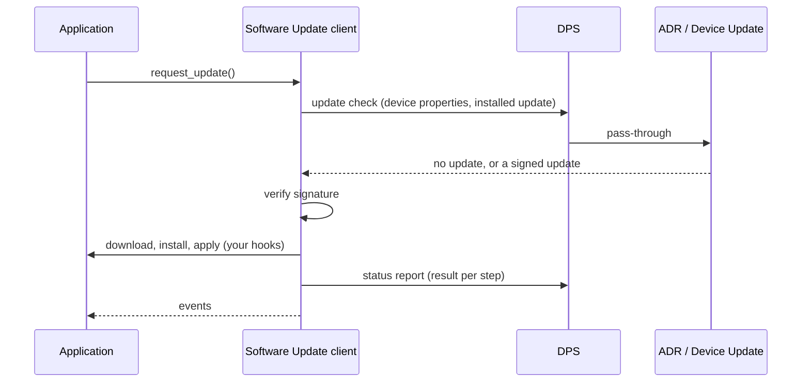
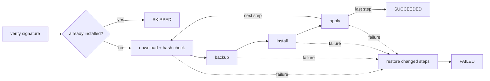
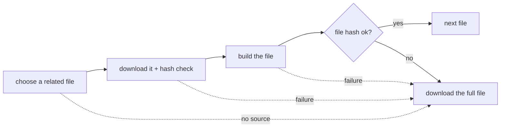

<!-- Copyright (c) Microsoft. All rights reserved.
     Licensed under the MIT license. See LICENSE file in the project root for full license information. -->

# Software Update

Keep devices up to date with [Azure Device Update](https://learn.microsoft.com/azure/iot-hub-device-update/):
the device asks for updates, verifies them, installs them through your code, and reports the
result. The API is [`az_iot_su.h`](../inc/azure/iot/az_iot_su.h), which documents every function,
option and event in full.

- [How it works](#how-it-works)
- [Before you start](#before-you-start)
- [Choose an integration](#choose-an-integration)
- [Quick start](#quick-start)
- [Checking for updates](#checking-for-updates)
- [Platform hooks](#platform-hooks)
- [Workflow, steps and results](#workflow-steps-and-results)
- [Reboot and resume](#reboot-and-resume)
- [Delta updates](#delta-updates)
- [Library mode](#library-mode)
- [Trust and root keys](#trust-and-root-keys)
- [Device properties](#device-properties)
- [Events](#events)
- [Retries, duplicates and cancellation](#retries-duplicates-and-cancellation)
- [Troubleshooting](#troubleshooting)
- [Memory and limits](#memory-and-limits)
- [Samples](#samples)
- [Limitations](#limitations)

## How it works

The device **pulls** updates over its DPS connection. DPS passes each request to Azure Device
Registry (ADR), which forwards it to Device Update. The device reuses its DPS X.509 identity: it
needs no Software Update credential and never talks to Device Update directly.



The client runs inside your `do_work()` loop, single-threaded, with no heap allocation: you provide
its memory. Each `do_work()` does one bounded piece of work, provided your hooks return
`IN_PROGRESS` for long work. Two steps take one call however long they run: the SHA-256 check of a
downloaded file reads the whole file through `read_file_fn`, and the reference delta processor
builds a whole file by default ([Delta updates](#delta-updates)).

## Before you start

**Service side**
- A DPS enrollment for the device, with **X.509** attestation.
- An ADR namespace linked to DPS and to a Device Update instance.
- An update imported and deployed to devices whose compatibility properties match
  ([import manifest](https://learn.microsoft.com/azure/iot-hub-device-update/update-manifest)).
- A linked IoT Hub only for the [regular route](#checking-for-updates).

**Device side**
- A connection client with DPS settings and a certificate provider: [connecting.md](connecting.md).
- A crypto backend with RSA verification on the connection client (`az_iot_crypto_openssl()` or
  `az_iot_crypto_mbedtls()`): [connecting.md § Crypto backend](connecting.md#crypto-backend).
- Root keys: Microsoft's are compiled in ([Trust and root keys](#trust-and-root-keys)).
- Build and dependencies: [dependencies.md](dependencies.md),
  [samples/README.md](../samples/README.md).

## Choose an integration

| Integration | You implement | The SDK does | Start from |
|---|---|---|---|
| **Managed** (most devices) | [Platform hooks](#platform-hooks): download, install, apply, persist | Checks, verification, workflow, retries, reports | [simulated_regular](../samples/software_update/pc/simulated_regular/README.md) |
| **Library mode** (you already have an update agent) | Download, install, report through `az_iot_su_client_report_status()` | Checks, verification, report delivery and retries | [library_mode](../samples/software_update/pc/library_mode/README.md) |
| **Primitives** (your own transport) | Everything except the trust checks | `az_iot_su_verify_manifest()`, `az_iot_su_parse_update_request()`, `az_iot_su_verify_file_hash()`, `az_iot_su_build_report()` | [`az_iot_su.h`](../inc/azure/iot/az_iot_su.h) ("Transport-free primitives") |

## Quick start

The managed client, after the connection client is initialized
([connecting.md § Minimal setup](connecting.md#minimal-setup)). Taken from
[simulated_regular/main.c](../samples/software_update/pc/simulated_regular/main.c).

```c
static uint8_t su_workspace[AZ_IOT_SU_WORKSPACE_DEFAULT_SIZE]; /* for the default limits */

az_iot_su_platform_hooks hooks = { 0 };
hooks.download_fn = my_download;               /* see Platform hooks */
hooks.read_file_fn = my_read_file;
hooks.install_fn = my_install;
hooks.apply_fn = my_apply;
hooks.persist_workflow_state_fn = my_persist;
hooks.load_workflow_state_fn = my_load;
hooks.user_ctx = &my_context;

az_iot_su_device_properties props = { 0 };
props.manufacturer = "Contoso";                /* matched against the deployed update */
props.model = "Sensor-1";
props.installed_update_id = (az_iot_su_update_id_info){ "Contoso", "Sensor-1", "1.0.0" };

size_t root_key_count = 0;
az_iot_su_client_config_options opts = az_iot_su_client_config_options_default();
opts.hooks = &hooks;
opts.root_keys = az_iot_su_microsoft_root_keys(&root_key_count);
opts.root_key_count = root_key_count;
opts.device_properties = &props;               /* copied */
opts.workspace = su_workspace;
opts.workspace_size = sizeof(su_workspace);

if (az_iot_su_client_init(&su, &connection, &opts) != AZ_IOT_OK
    || az_iot_su_client_add_observer(&su, on_su_event, &my_context) != AZ_IOT_OK)
{
  return 1;
}
if (az_iot_su_client_resume(&su) != AZ_IOT_OK) /* finishes a workflow a reboot interrupted */
{
  /* nothing usable was stored: start from Idle */
}
if (az_iot_su_client_get_state(&su) == AZ_IOT_SU_STATE_IDLE
    && az_iot_su_client_request_update(&su, AZ_IOT_SU_REQUEST_DEFAULT_TIMEOUT_MS) != AZ_IOT_OK)
{
  return 1;
}
if (az_iot_connection_client_open(&connection) != AZ_IOT_OK)
{
  return 1;
}

for (;;)
{
  (void)az_iot_connection_client_do_work(&connection, 50);
  (void)az_iot_su_client_do_work(&su);
  if (az_iot_su_client_get_reboot_state(&su) == AZ_IOT_SU_REBOOT_READY)
  {
    my_reboot(); /* state is saved; resume() continues after the restart */
  }
  /* request_update() again on your schedule: see Checking for updates */
}
```

> **Note** Add the observer before `resume()`: a resumed workflow is reported through it. Reboot
> as soon as the client asks ([Reboot and resume](#reboot-and-resume)): until then the next
> `do_work()` carries on as if the device had restarted.

## Checking for updates

The application chooses **when** to check and **which route**. The client checks on its own only once
after the service rejects a status report as conflicting (`REPORT_CONFLICT`, or an untyped `409000`),
final or in progress, on the route last requested. Like any check, that one pauses the hub session
(see the note below), even while an update is running.

| Route | Call | When |
|---|---|---|
| Onboarding | `az_iot_su_client_request_onboarding_update()` | Before the device is registered (no device record yet), e.g. to bring a factory image up to date before first use. Works with `dps.provision_only`. |
| Regular | `az_iot_su_client_request_update()` | After the device has registered, which creates its device record. |

- **Cadence.** Check at startup, every 4 hours, and once more after each applied update (until
  "no update"). All devices share the provisioning service's request budget, which is planned for
  about one check per device every 4 hours.
- **Timeout.** Every call takes a wall-clock bound; on expiry the check is dropped and
  `AZ_IOT_SU_EVENT_OPERATION_ABANDONED` is raised. Use `AZ_IOT_SU_REQUEST_DEFAULT_TIMEOUT_MS`
  (120 s) unless you have your own policy.
- **One pending check.** A new request replaces one not yet answered.
- **Registration.** A check asked before `open()` holds registration until it is answered, at most
  `AZ_IOT_DPS_HOLD_TIMEOUT_MS` (60 s); the device registers either way.

> **Note** The SDK runs one MQTT session at a time. A check or report made while the hub is
> connected pauses the hub session (telemetry, twin, methods) until it ends, then reconnects
> without registering again. Schedule checks when that is acceptable.
> [connecting.md § One MQTT session at a time](connecting.md#one-mqtt-session-at-a-time).

Samples: [simulated_onboarding](../samples/software_update/pc/simulated_onboarding/README.md),
[simulated_regular](../samples/software_update/pc/simulated_regular/README.md).

## Platform hooks

Your code does the device-side work. Every hook gets `hooks.user_ctx`, returns an
`AZ_IOT_SU_RESULT_*` code, and runs on the `do_work()` thread.

| Hook | Needed | Called | May return |
|---|---|---|---|
| `download_fn` | Yes | Once per file (and per related file, see [Delta updates](#delta-updates)) | `SUCCESS`, `IN_PROGRESS`, `FAILURE` |
| `read_file_fn` | Yes, unless your platform checks each file's integrity itself; required with download handlers | After each download, to check its SHA-256 against the signed manifest. NULL skips the check: the signature covers the manifest, not the downloaded bytes. | `SUCCESS`, `FAILURE` |
| `is_installed_fn` | Optional | Before anything is downloaded | `ALREADY_INSTALLED` (reported `SKIPPED`), `SUCCESS` |
| `backup_fn` | Optional | Before each step's install | `SUCCESS`, `IN_PROGRESS`, `FAILURE` |
| `install_fn` | Yes | Once per step | `SUCCESS`, `IN_PROGRESS`, `REBOOT_REQUIRED`, `FAILURE` |
| `apply_fn` | Optional (NULL succeeds) | Once per step, after install | `SUCCESS`, `IN_PROGRESS`, `REBOOT_REQUIRED`, `FAILURE` |
| `restore_fn` | Optional | On failure, for each step already changed, in reverse | `SUCCESS`, `FAILURE` |
| `persist_workflow_state_fn` / `load_workflow_state_fn` | Needed to survive a reboot | At reboot points and when a workflow ends | 0 on success |

- `IN_PROGRESS` calls the hook again on the next `do_work()`: do long work in chunks.
- A failing hook's return value is reported in the low bits of the step's extended result code.
- `persist_workflow_state_fn` must replace the record **atomically and durably** (write a temporary
  file, `fsync()`, `rename()`, `fsync()` the directory; on ESP-IDF, `nvs_set_blob()` then
  `nvs_commit()`). A length of 0 means erase.

Ready-made hooks: the ESP32 OTA adapter
([platforms/esp32](../platforms/esp32/README.md)). Real downloads with libcurl:
[http_download](../samples/software_update/pc/http_download/README.md).

## Workflow, steps and results

An update has up to 10 steps and 10 files. Each step downloads its files, then runs backup, install
and apply. A failure restores the changed steps in reverse order and reports the update failed.



- The service sees one result per step: outcome, result code (700 on success, negative on
  failure) and an extended result code whose top 4 bits say which phase failed
  (`AZ_IOT_SU_FACILITY_*`).
- Add human-readable text to a step with `az_iot_su_client_set_step_result_details()` (128 bytes by
  default).
- After a success the client sends the applied update as installed on later checks; you need not
  call `az_iot_su_client_update_device_properties()` for it.

Sample: [multi_step](../samples/software_update/pc/multi_step/README.md). Limits:
[client-configuration.md § Software updates manifest limits](client-configuration.md#software-updates-manifest-limits).
Result codes: `AZ_IOT_SU_FACILITY_*` and `AZ_IOT_SU_MANIFEST_ERROR_*` in [`az_iot_su.h`](../inc/azure/iot/az_iot_su.h).

## Reboot and resume

When `install_fn` or `apply_fn` returns `REBOOT_REQUIRED`, the client saves the workflow through
`persist_workflow_state_fn`. Then:

1. After each `do_work()`, read `az_iot_su_client_get_reboot_state()`:
   - `AZ_IOT_SU_REBOOT_READY`: reboot now.
   - `AZ_IOT_SU_REBOOT_PENDING`: storage is behind (a write is failing); do not reboot yet.
2. At startup, call `az_iot_su_client_resume()` before any update check. The workflow continues
   where it stopped, and an unsent final report is sent.

Use `get_reboot_state()` before any planned shutdown too. Sample:
[reboot_resume](../samples/software_update/pc/reboot_resume/README.md).

## Delta updates

A delta update ships only the difference from an earlier version. In the import manifest a file
names a download handler (e.g. `microsoft/delta:1`) and lists **related files** (the deltas). The
client asks your registered handler to build the file from a related file, and checks the result:



A delta that cannot be used never fails the update: the full file is downloaded, and the step
reports an `AZ_IOT_SU_FACILITY_DELTA` extended code so you can see why.

**Reference handler `microsoft/delta:1`** (Linux):
- Build with `-DAZ_IOT_WITH_SU_DELTA=ON` (on in the Linux presets); link `azure::iot::su_delta`;
  header [`az_iot_su_delta.h`](../adapters/su/delta/az_iot_su_delta.h).
- Register it: `az_iot_su_delta_handler_init()`, then put
  `az_iot_su_delta_handler_get_download_handler()` in `download_handlers` of the client options.
- Tell it where your `download_fn` stores each file (`get_file_path_fn`).
- The default processor builds a file in one `do_work()` call, which blocks your loop for that
  long. To keep the loop responsive, set `apply_delta_fn` to run the processor elsewhere and return
  `AZ_IOT_SU_RESULT_IN_PROGRESS` until it is done.
- It loads the delta processor `libadudiffapi.so` from
  [Azure/iot-hub-device-update-delta](https://github.com/Azure/iot-hub-device-update-delta) at run
  time ([install script](../eng/install-su-delta-processor.sh)). Without it, files are downloaded in
  full.
- It keeps the files of the last successful update per provider in a source cache, as the sources
  of the next delta. The first update is therefore a full download, unless you seed the cache
  (`az_iot_su_delta_handler_get_source_cache_path()`).

**Your own handler:** fill an `az_iot_su_download_handler` (`choose_related_file_fn`,
`build_file_from_related_fn`, optional `workflow_ended_fn`). On Windows and ESP32, where the
reference handler is not available, files are downloaded in full unless you register your own.

Samples: [http_download § Delta updates](../samples/software_update/pc/http_download/README.md#delta-updates),
[simulated_regular § Delta updates](../samples/software_update/pc/simulated_regular/README.md#delta-updates).
API: `az_iot_su_download_handler` and `AZ_IOT_SU_DELTA_ERROR_*` in [`az_iot_su.h`](../inc/azure/iot/az_iot_su.h);
the reference handler's options in [`az_iot_su_delta.h`](../adapters/su/delta/az_iot_su_delta.h).

## Library mode

For an existing update agent: the client keeps the service side (checks, signature verification,
report delivery and retries) and hands each verified update to your code.

1. Set `opts.library_mode = true`; no hooks and no download handlers.
2. On `AZ_IOT_SU_EVENT_UPDATE_AVAILABLE`, take `event->request` (workflow id, file URLs) and
   `event->manifest`. They stay valid until your final report.
3. Download, check each file with `az_iot_su_verify_file_hash()`, install.
4. Report progress and the outcome with `az_iot_su_client_report_status()`, one result per step.

`az_iot_su_client_get_current_update()` returns the current update in either mode.

> **Note** Library mode is not persisted: after a restart the service offers the update again.
> Delta files reach your code as related files; applying them is up to you.

Sample: [library_mode](../samples/software_update/pc/library_mode/README.md).

## Trust and root keys

Nothing is downloaded until the update's signature checks out:

- root key → signing key → manifest → each file's SHA-256;
- RS256 only;
- a root key marked `disabled` is rejected.

`az_iot_su_microsoft_root_keys()` returns Microsoft's three production root keys. To trust your own
roots, pass your own `az_iot_su_root_key` array (up to `limits.max_root_keys`, 8 by default).

> **Note** Root keys change only with a firmware update: plan key updates into your firmware.

## Device properties

Sent on every check, so the service offers the right update:

| Property | Notes |
|---|---|
| `manufacturer`, `model`, `custom_properties` | **Compatibility properties**: 1 to 5 in total; each must match the deployed update. A mismatch looks exactly like "no update". |
| `installed_update_id` | What is installed (provider, name, version), or all NULL. The service does not offer that update again. |

- They are copied at `init()`; change them with `az_iot_su_client_update_device_properties()`.
- Size: `az_iot_su_device_properties_buffer_size()` gives the bytes needed; keep it within
  `limits.device_properties_size` (512 by default).
- Service limits: names up to 32 and values up to 64 characters.

## Events

Register with `az_iot_su_client_add_observer()`. Events arrive on the `do_work()` thread; the event
is valid only during the callback. Names below omit the `AZ_IOT_SU_EVENT_` prefix.

| Event | Meaning | What to do |
|---|---|---|
| `WORKFLOW_STATE_CHANGED` | The workflow moved; into `FAILED` it carries `reason` and `extended_result_code` | Log; show progress |
| `WORKFLOW_COMPLETED` | The final report is settled (`report` holds it) | After a success, check again for the next update |
| `NO_UPDATE` | A check found nothing | Wait for the next check |
| `REPORT_ACCEPTED` | The service accepted a report | — |
| `OPERATION_ABANDONED` | A check or report was given up (`operation`, `reason`, `service_error`) | A check: log `service_error` and ask again later on the **same** route. A report: log only; the client reports again at its next reporting point (a rejected final report: see the header) |
| `UPDATE_REFUSED` | An offer is too large or malformed; not processed | Raise the limit named by `reason`, or fix the update |
| `UPDATE_DEFERRED` | A new update waits: the current one has started installing (or awaits its reboot) | Ask again once the current one ends |
| `UPDATE_DUPLICATE` | The same update was offered again | — |
| `UPDATE_RETRY_WAIT` | A failed update was offered before its retry time | Ask again after `retry_after_ms` |
| `PERSIST_FAILED` / `PERSIST_RECOVERED` | `persist_workflow_state_fn` is failing / works again | Do not reboot while failing |
| `UPDATE_AVAILABLE` | Library mode: the verified update is yours | See [Library mode](#library-mode) |

## Retries, duplicates and cancellation

- **Transient service errors** are retried by the client (1 s doubling to 60 s, or the service's
  `Retry-After`), within the request timeout.
- **A failed update** offered again is retried after 1 h, doubling up to 24 h, with jitter. The wait
  survives a restart when persistence is set.
- **A new update while one runs** replaces it until its first `install_fn` call: an update still
  downloading is dropped for the new one. From the first install it waits (`UPDATE_DEFERRED`) until
  the current one ends, and after its reboot if it asked for one.
- **Cancellation** is done from the service: it stops offering the update. The device has no cancel
  call.

## Troubleshooting

Turn on the `su` and `dps` log components at `DEBUG` ([logging.md](logging.md)).

| Symptom | Likely cause | Fix |
|---|---|---|
| Always `NO_UPDATE` | Compatibility properties do not match the update, or it is already installed | Compare the properties the device sends with the update's `compatibility` |
| Regular check `OPERATION_ABANDONED`, `INVALID_REQUEST` | The device has no device record yet | Use the onboarding route until it registers |
| `OPERATION_ABANDONED`, `UPDATE_ACCOUNT_NOT_LINKED` or `..._ACCESS_DENIED` | ADR namespace not linked to Device Update | Fix the link; provisioning is not blocked |
| `FAILED`, facility `0x1` (`AZ_IOT_SU_FACILITY_MANIFEST`) | Signature not trusted: unknown or disabled root key | Pass the right root keys; the sub-code says which check failed |
| `FAILED`, facility `0x3` (`HASH`) | A downloaded file differs from the signed one | Check `download_fn` and `read_file_fn` |
| `UPDATE_REFUSED` with `AZ_IOT_ERR_NOT_ENOUGH_SPACE` | The update exceeds `max_update_size` or the file limits | Raise the limit ([Memory and limits](#memory-and-limits)) |
| `init()` returns `AZ_IOT_ERR_INVALID_ARG` | Missing hooks, root keys, properties or workspace; or a build mismatch | The `ERROR` log names the cause |

For support, include the event's `service_error.tracking_id`.

## Memory and limits

The client lives in memory you provide: `AZ_IOT_SU_WORKSPACE_DEFAULT_SIZE` bytes for the default
`az_iot_su_limits`, or `az_iot_su_workspace_size()` / `AZ_IOT_SU_WORKSPACE_SIZE()` for your own. The
largest update accepted is 64 KiB by default; steps and files per update are build options (10 and
10). Every limit: [client-configuration.md § Software updates](client-configuration.md#software-updates-az_iot_suh).

## Samples

| Sample | Shows | Real / simulated |
|---|---|---|
| [simulated_onboarding](../samples/software_update/pc/simulated_onboarding/README.md) | Onboarding route, no IoT Hub | Service real; download and install simulated |
| [simulated_regular](../samples/software_update/pc/simulated_regular/README.md) | Regular route, polling, delta handler | Service real; download and install simulated |
| [http_download](../samples/software_update/pc/http_download/README.md) | Non-blocking libcurl download, proxy, delta | Service and download real; install simulated |
| [multi_step](../samples/software_update/pc/multi_step/README.md) | Several steps, rollback, step details | Service real; download and install simulated |
| [reboot_resume](../samples/software_update/pc/reboot_resume/README.md) | Atomic persistence, reboot, resume | Service real; download and install simulated |
| [library_mode](../samples/software_update/pc/library_mode/README.md) | Your agent installs and reports | Service real; download and install simulated |
| [esp32](../samples/software_update/esp32/README.md) | Over-the-air firmware update on ESP32 | All real (see [Limitations](#limitations)) |

PC samples run on Linux and Windows.

## Limitations

- Updates go over DPS only; there is no IoT Hub route.
- Only X.509 device authentication is supported for Software Update.
- No root key package download or rotation, and no signing-key revocation.
- Not supported: component targeting, proxy (gateway-to-leaf) updates, reference steps, step
  handlers (apt, script, swupdate), Delivery Optimization, log upload.
- No built-in health check or automatic rollback after a reboot.
- `AZ_IOT_SU_REPLACEMENT_ROLLBACK` is not supported yet.
- An update refused by the device (`UPDATE_REFUSED`) is not reported to the service, which keeps
  offering it.
- A skipped update is reported with result code -1.
- During a service outage a check is retried until its timeout, not deferred to the next scheduled
  check.
- Compatibility property lengths are not checked on the device; a value the service rejects fails
  every check.
- The ESP32 sample is built and boot-tested in CI (QEMU), but not yet validated on hardware
  against the service.
- C only; there is no .NET Software Update client.
