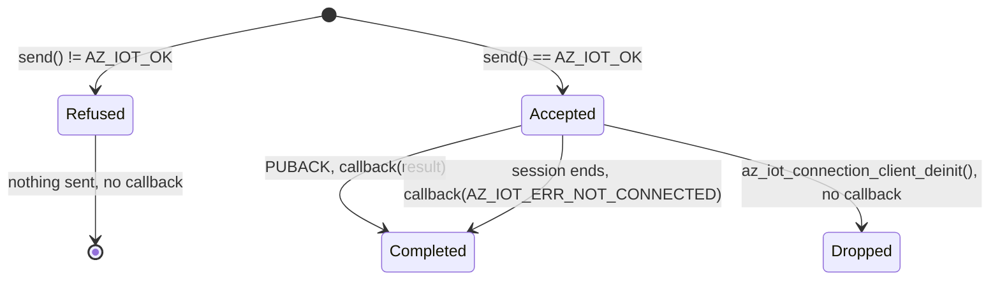

<!-- Copyright (c) Microsoft. All rights reserved.
     Licensed under the MIT license. See LICENSE file in the project root for full license information. -->

# Sending telemetry

What `az_iot_mqttv3_telemetry_client_send()` and `az_iot_mqttv5_telemetry_client_send()`
guarantee, and what is left to the application. The headers,
[mqttv3](../inc/azure/iot/mqttv3/az_iot_telemetry_client.h) and
[mqttv5](../inc/azure/iot/mqttv5/az_iot_telemetry_client.h), are the reference.

## Delivery contract

| Topic | Behavior |
| --- | --- |
| Completion | Each accepted send gets exactly one callback. It is the only completion signal. |
| Pending sends | No query. Count them yourself: accepted sends minus callbacks. |
| Capacity | Telemetry shares the `AZ_IOT_MAX_PENDING_PUBACKS` pool ([sizing](client-configuration.md#in-flight-qos-1-publishes)). When it is full, `send()` returns `AZ_IOT_ERR_BUSY` and sends nothing. |
| Acknowledgement detail | The callback result: `AZ_IOT_OK`; on mqttv5 also `AZ_IOT_ERR_PUBLISH_REFUSED`, `AZ_IOT_ERR_BUSY` (quota) or `AZ_IOT_ERR_MQTT` (other reason codes). Packet ids are not exposed: the adapter reuses them. |
| Cancellation | None. An accepted PUBLISH is already with the transport. |
| Offline | No buffering. While not connected, `send()` returns `AZ_IOT_ERR_NOT_CONNECTED`. Persist and resend in the application. |
| Session ends | Pending sends complete with `AZ_IOT_ERR_NOT_CONNECTED` (also on `az_iot_connection_client_close()`). Delivery is unknown; QoS 1 is at-least-once, so resend if needed. The SDK does not resend them. |
| Telemetry client deinit | Does not cancel: pending callbacks still run. Keep their context valid. |
| Connection deinit | Pending sends are dropped without a callback. |
| QoS | Always 1. For QoS 0 on mqttv5, publish on a [custom topic](../inc/azure/iot/mqttv5/az_iot_custom_topic_client.h). |

## mqttv5 message properties

| Property | Sent as |
| --- | --- |
| `$.ct` (`AZ_IOT_MSG_PROP_CONTENT_TYPE`) | Content Type, and a `content-type` user property. Default `application/json`. |
| `$.cid` (`AZ_IOT_MSG_PROP_CORRELATION_ID`) | Correlation Data, UTF-8, at most 65535 bytes. The hub reads the correlation id only from there. |
| Others | User properties, verbatim. |

No Message Expiry Interval is sent: the hub routes telemetry on arrival and does not carry it.
Custom topics accept one (`message_expiry_seconds`).
