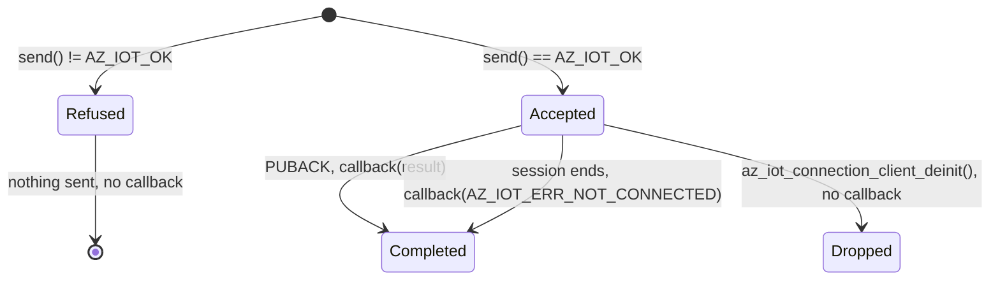

<!-- Copyright (c) Microsoft. All rights reserved.
     Licensed under the MIT license. See LICENSE file in the project root for full license information. -->

# Sending telemetry

What `az_iot_mqttv3_telemetry_client_send()` guarantees, and what is left to the application. The
header, [az_iot_telemetry_client.h](../inc/azure/iot/mqttv3/az_iot_telemetry_client.h), is the
reference.

## Delivery contract

| Topic | Behavior |
| --- | --- |
| Completion | Each accepted send gets exactly one callback, unless the connection is deinitialized first (see below). It is the only completion signal. |
| Pending sends | No query. Count them yourself: accepted sends minus callbacks; after connection deinit, none are pending. |
| Capacity | Telemetry shares the `limits.max_pending_publishes` pool ([sizing](client-configuration.md#in-flight-qos-1-publishes)). When it is full, `send()` returns `AZ_IOT_ERR_BUSY` and sends nothing. |
| Acknowledgement detail | The callback result: `AZ_IOT_OK`. Packet ids are not exposed: the adapter reuses them. |
| Cancellation | None. An accepted PUBLISH is already with the transport. |
| Offline | No buffering. While not connected, `send()` returns `AZ_IOT_ERR_NOT_CONNECTED`. Persist and resend in the application. |
| Session ends | Pending sends complete with `AZ_IOT_ERR_NOT_CONNECTED` (also on `az_iot_connection_client_close()`). Delivery is unknown; QoS 1 is at-least-once, so resend if needed. The SDK does not resend them. |
| Telemetry client deinit | Does not cancel: pending callbacks still run. Keep their context valid. |
| Connection deinit | Pending sends are dropped without a callback. |
| QoS | Always 1. |

