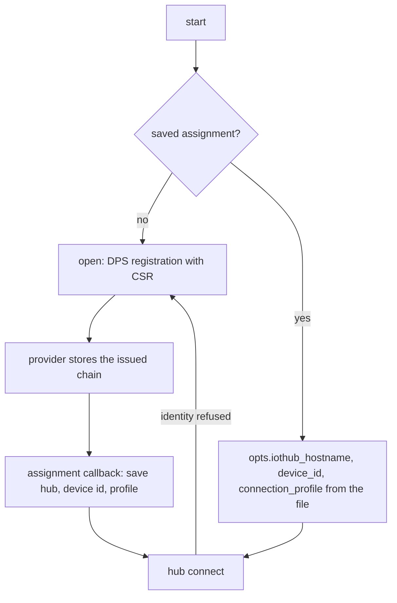

<!-- Copyright (c) Microsoft. All rights reserved.
     Licensed under the MIT license. See LICENSE file in the project root for full license information. -->

# Persist and restore the DPS assignment

Registers with DPS once, saves the assignment, and on later runs connects straight to the
assigned hub with the operational certificate DPS issued, without registering again.



See [`main.c`](main.c) and [connecting.md](../../../docs/connecting.md#saved-hub-with-dps-fallback).

## Setup

As [`dps_csr_managed`](../dps_csr_managed/README.md): the same Azure resources, bootstrap
identity, enrollment group and environment variables.

The assignment is saved to `dps_assignment.txt` in the working directory: three lines, hub
hostname, device id, and `mqttv3` or `mqttv5`. Delete it to
register again. Keep it with `AZ_IOT_OPERATIONAL_KEY` and `AZ_IOT_OPERATIONAL_CERT`: the
saved identity is only usable with the certificate issued alongside it.

## Build and run

From `c/`:

```sh
cmake --preset linux-gcc-debug
cmake --build --preset linux-gcc-debug --target az_iot_sample_auth_dps_persist_assignment
./build/linux-gcc-debug/samples/authentication/az_iot_sample_auth_dps_persist_assignment   # registers
./build/linux-gcc-debug/samples/authentication/az_iot_sample_auth_dps_persist_assignment   # restores
```

Built when OpenSSL 3.0+ and the Paho adapter are available (`AZ_IOT_WITH_CERT_PROVIDER_MANAGED`,
`AZ_IOT_WITH_PAHO`). Connects to mqttv3 and mqttv5 hubs.

## Behavior

- Identity recovery is `AZ_IOT_IDENTITY_RECOVERY_REPROVISION`, paced by the reconnection policy
  instead of the 5 minute default: if the hub refuses the saved identity, the client registers
  with DPS and the new assignment is saved. The refusal does not end the run.
- Exit code 0 when the hub connects and any new assignment was saved; otherwise 1.
- The file is rewritten in place. A production device should write a temporary file and rename
  it, so a power loss cannot leave a partial assignment.

## Expected output

SDK log lines omitted. First run:

```
[persist] no saved assignment in dps_assignment.txt; registering with DPS
[persist] assigned hub=<hub>.azure-devices.net device_id=<id> profile=mqttv3; save to dps_assignment.txt: ok
[persist] hub: Connected (AZ_IOT_OK)
[persist] connected to <hub>.azure-devices.net (new assignment)
```

Later runs:

```
[persist] restoring hub=<hub>.azure-devices.net device_id=<id> profile=MQTTv3 (MQTT v3.1.1) from dps_assignment.txt
[persist] hub: Connected (AZ_IOT_OK)
[persist] connected to <hub>.azure-devices.net (restored assignment)
```
