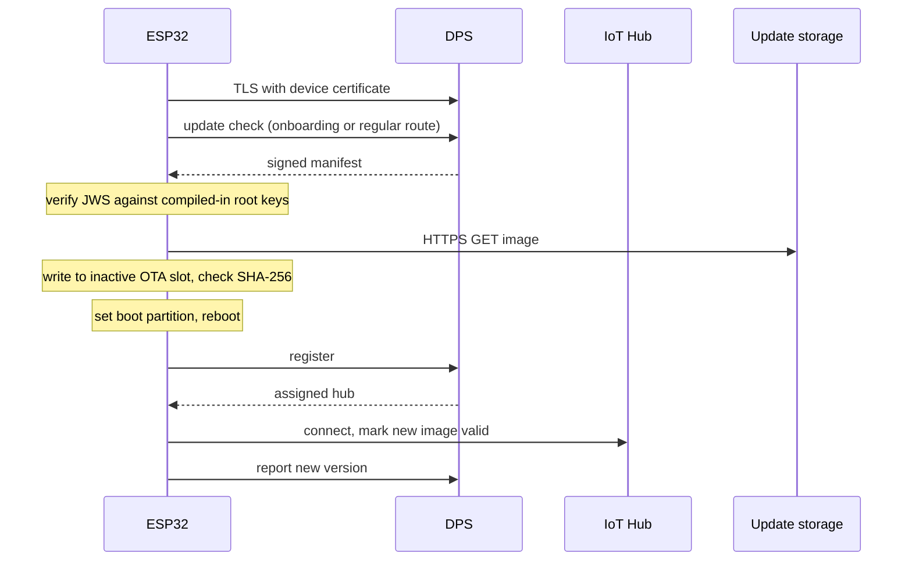

<!--
Copyright (c) Microsoft. All rights reserved.
Licensed under the MIT license. See LICENSE file in the project root for full license information.
-->

# Software Updates Sample - Real OTA Firmware Update on ESP32

This sample performs a **genuine over-the-air firmware update** on an ESP32 using
Azure software updates. Unlike the [PC samples](../pc/simulated_onboarding/README.md),
nothing is simulated: the payload is a real ESP32 app image, flashed into the
inactive OTA slot and booted.



## Sample features
- Target platform: **ESP32** (ESP-IDF v6.0 or later), any chip revision.
- Real download, install, reboot and automatic rollback; nothing simulated.
- Asks on the onboarding route until it has connected to its hub, then on the
  regular route every `SU_POLL_INTERVAL_S`. See [Update-check route](#update-check-route).
- MQTT over the SDK's [az_mqtt adapter](../../../adapters/az_mqtt) (`c/deps/az_mqtt`, ESP-IDF's
  mbedTLS); mbedTLS PSA Crypto (manifest verification); `esp_http_client` + `app_update` (OTA).
- Optional [production security profile](#production-security-profile-optional),
  off by default.

### How the OTA flow works

| Platform hook | ESP32 implementation |
|---|---|
| `download` | `esp_http_client` GET → `esp_ota_write` into the next OTA partition |
| `read_file` | `esp_partition_read`, so core can run the SHA-256 check on the written image |
| `is_installed` | Compares the manifest version with `SU_UPDATE_VERSION` |
| `install` | `esp_ota_end` + `esp_ota_set_boot_partition`; returns `REBOOT_REQUIRED` |
| `apply` | No-op; the new image is already running |
| `restore` | Rollback to the running partition |
| `persist` / `load` state | NVS namespace `su_sample`, key `wf_state` (resume across the reboot). The 36 KB `nvs` partition holds two generations of the largest checkpoint; [main/app_main.c](main/app_main.c) sets `limits.max_update_size` to 8192 (`SU_MAX_UPDATE_SIZE`) to bound it. Erase the flash when moving from the earlier 24 KB layout. |

Once connected to its hub, the new image calls `az_iot_su_esp32_ota_mark_running_image_valid()`
(`esp_ota_mark_app_valid_cancel_rollback`). If it crashes or never connects, the
bootloader returns to the previous slot (`CONFIG_BOOTLOADER_APP_ROLLBACK_ENABLE`).

### Update-check route

A device that has never connected to its hub has no device record, so it asks on
the onboarding route (`az_iot_su_client_request_onboarding_update()`). After its
first hub connection it records that in NVS (namespace `su_app`, key `registered`)
and asks on the regular route (`az_iot_su_client_request_update()`) from then on.
`idf.py erase-flash` returns it to the onboarding route.

An update is offered only on the route matching its job type. A check not
answered within half the poll interval (at most 60 s) is abandoned and asked again
at the next poll. No check is made while a deployment is in flight.

## Service requirements
- Azure Device Provisioning service, with an X.509 enrollment for the device and a
  linked Azure IoT Hub.
- Azure Device Update, in the DPS-fronted model the [PC samples](../pc/simulated_onboarding/README.md)
  use.

## Configure

### Device identity

The device certificate and key are not in the image: they come from the `esp_secure_cert`
partition (0xD000; 0x11000 in the [security profile](#production-security-profile-optional)),
read by the [esp_secure_cert certificate provider](../../../adapters/cert_esp_secure_cert/az_iot_certificate_provider_esp_secure_cert.h)
(`espressif/esp_secure_cert_mgr`). The certificate CN must equal `SU_DPS_REGISTRATION_ID`.

| Chip | Key |
|---|---|
| ESP32-S3, ESP32-C3, ESP32-C6 | Digital Signature (DS) peripheral: an RSA key, encrypted with an eFuse key that only the peripheral uses once read-protected (below). TLS signs with it as a PSA key. |
| ESP32 | PEM key in the partition, read into RAM for each connection and wiped after. Flash encryption (security profile) protects it at rest. |

Write the partition with Espressif's `configure_esp_secure_cert.py`
(`pip install esp-secure-cert-tool`) after `idf.py flash`; `idf.py flash` leaves it in place,
`idf.py erase-flash` erases it. These commands are for development:

```sh
# ESP32-S3/C3/C6: --configure_ds burns the eFuse key block --efuse_key_id (irreversible).
configure_esp_secure_cert.py -p PORT --target_chip esp32c3 --secure_cert_type cust_flash_tlv \
    --device-cert device_cert.pem --private-key device_key.pem \
    --configure_ds --priv_key_algo RSA 2048 --efuse_key_id 3
# ESP32:
configure_esp_secure_cert.py -p PORT --target_chip esp32 --secure_cert_type cust_flash_tlv \
    --device-cert device_cert.pem --private-key device_key.pem
```

`--priv_key_algo` must match the key (RSA and its size). The tool burns the DS key block
**without read protection**, so its key can still be read and used to decrypt the DS data off
the chip. For production, read-protect it right after provisioning and check that
`espefuse.py -p PORT summary` reports the block as read-protected:

```sh
espefuse.py --chip esp32c3 -p PORT read_protect_efuse BLOCK_KEY3
```

With the [security profile](#production-security-profile-optional), provision **before the
first boot of the secure build**: its first boot enables release-mode flash encryption and, on
ESP32 rev v3.0+, disables serial download, after which the partition can no longer be written.
Per device:

1. Provision as above with `--sec_cert_part_offset 0x11000`. The partition is written in
   plaintext; the first secure boot encrypts it with the app (`encrypted` flag in
   [`partitions_secure.csv`](partitions_secure.csv)). On ESP32-S3/C3/C6 keep the DS key in
   block 3 and read-protect it: the first secure boot puts its Secure Boot and flash encryption
   keys in the first free blocks (0 and 1), and NVS encryption creates its key in block 2.
   The [virtual eFuse rehearsal](#production-security-profile-optional) burns nothing, but
   `--configure_ds` and `read_protect_efuse` burn real eFuses: for it, provision as on ESP32
   (no `--configure_ds`, no read protection); its profile turns DS off and uses the PEM key.
2. Flash and boot the secure build.

For production key custody, see [Production keys](../../../docs/connecting.md#production-keys).

`main/certs/trusted_ca.pem` (optional, compiled in) is the CA for the DPS and hub **server**
certificates. Leave the placeholder to use the ESP-IDF certificate bundle, which trusts the
Azure roots.

### Settings

Set with `idf.py menuconfig` → *Software Updates ESP32 Sample Configuration*
([`main/Kconfig.projbuild`](main/Kconfig.projbuild)), and the Wi-Fi network under *Example
Connection Configuration* (ESP-IDF's
[`protocol_examples_common`](https://github.com/espressif/esp-idf/tree/v6.0/examples/common_components/protocol_examples_common)).
Values land in the git-ignored `sdkconfig`.

| Setting | Required | Meaning |
|---|---|---|
| `EXAMPLE_WIFI_SSID` | yes | Wi-Fi network. |
| `EXAMPLE_WIFI_PASSWORD` | yes | Wi-Fi password. |
| `SU_DPS_ID_SCOPE` | yes | DPS ID scope. |
| `SU_DPS_REGISTRATION_ID` | yes | Registration id / device id; must equal the certificate CN. |
| `SU_POLL_INTERVAL_S` | no | Seconds between update checks once connected. Default `14400` (4 h), range 10–86400. All devices share the provisioning service's request budget, which plans for one check per device every 4 hours; use a shorter interval only for testing. |

**Matched against a deployed update.** A value that does not match the imported
update is answered "nothing for me", which looks exactly like "nothing deployed".
Change them in [`main/app_main.c`](main/app_main.c).

| Property | Value |
|---|---|
| Manufacturer | `Espressif` |
| Model | `ESP32-WROOM` |

**Reported, not matched.** The installed update id comes from
[`main/su_version.h`](main/su_version.h) and says what the firmware is.

| Property | Default |
|---|---|
| `SU_UPDATE_PROVIDER` | `Contoso` |
| `SU_UPDATE_NAME` | `ESP32-SU` |
| `SU_UPDATE_VERSION` | `1.0.0` |

### Root keys

Manifests are verified against `az_iot_su_microsoft_root_keys()`, Microsoft's
production software updates roots compiled into the SDK. See
[Root keys](../pc/simulated_onboarding/README.md#root-keys) in the PC sample.

## Build and run

### Prerequisites

- **[ESP-IDF v6.0](https://docs.espressif.com/projects/esp-idf/en/v6.0/esp32/get-started/index.html)
  or later** (CI builds with v6.1, and v6.0 as the minimum), with its environment exported in the
  shell (`export.sh`, `export.ps1` or `export.bat`).
- An **ESP32 board with 4 MB flash** (for example ESP32-DevKitC with an
  ESP32-WROOM-32 module) and its USB serial port.
- The `azure-sdk-for-c` submodule, which the ESP-IDF build compiles from source:

  ```sh
  git submodule update --init c/deps/azure-sdk-for-c
  ```

From the ESP Component Registry: `espressif/esp_secure_cert_mgr` (device identity, an exact
version) and `espressif/ethernet_init`, at the version ESP-IDF's `protocol_examples_common`
requires.

### Build and flash

From `c/samples/software_update/esp32`:

```sh
idf.py set-target esp32
idf.py menuconfig        # settings above
idf.py build flash monitor
```

Leave the monitor running; see [Expected output](#expected-output).

### CI builds

CI (`ci-c`, job `esp-idf`) builds this sample for esp32, esp32c3, esp32s3 and
esp32c6, with the default and the [production security](#production-security-profile-optional)
profiles, plus the esp32 legacy and virtual eFuse profiles, and the [QEMU](#run-in-qemu) profile
for esp32, esp32s3 and esp32c3, which it also boots in QEMU until it gets an IPv4 address. It builds
with ESP-IDF v6.1, and the default profile for esp32 with v6.0 too, the minimum. Any compiler
warning fails the build. To run one build the same way, from `c/`:

```sh
eng/esp-idf-build.sh samples/software_update/esp32 esp32c3 secure
```

Profiles: `default`, `secure`, `secure_esp32_legacy`, `secure_virtual_efuse`, `qemu`.
Secure builds are signed with a throwaway key and must not be flashed.

### Run in QEMU

QEMU emulates esp32, esp32s3 and esp32c3, but not Wi-Fi: [`sdkconfig.qemu`](sdkconfig.qemu)
switches the network to OpenCores Ethernet, which QEMU user networking connects to the host's
network. From `c/`, with ESP-IDF's QEMU installed (`idf_tools.py install qemu-xtensa qemu-riscv32`):

```sh
eng/esp-idf-build.sh samples/software_update/esp32 esp32c3 qemu /tmp/su
eng/esp-idf-qemu.sh /tmp/su/software_update-esp32-esp32c3-qemu/build esp32c3 "Got IPv4 event"
```

The image boots, gets `10.0.2.15` and then needs a device identity, or the sample stops at
`no device certificate in the esp_secure_cert partition`. Write the `esp_secure_cert` partition
([Device identity](#device-identity)) into the flash image with
`QEMU_FLASH_EXTRA="0xd000 esp_secure_cert.bin" eng/esp-idf-qemu.sh ...`. Each run writes a fresh
flash image, so NVS and OTA state do not persist. The full log is `qemu.log` in the build
directory. The `qemu` profile leaves Secure Boot and flash encryption off, as `default` does.
ESP-IDF's QEMU can emulate both
([QEMU guide](https://docs.espressif.com/projects/esp-idf/en/v6.0/esp32/api-guides/tools/qemu.html)),
but this sample has no profile that combines them with `qemu`.

### Deploy an update

1. Raise `SU_UPDATE_VERSION` in [`main/su_version.h`](main/su_version.h).
2. `idf.py build`, producing `build/su_esp32.bin`. For a device running the
   [security profile](#production-security-profile-optional), build with the same
   profile arguments and signing key instead, producing `build-secure/su_esp32.bin`:
   `idf.py "${SECURE[@]}" build` (PowerShell: `idf.py @secure build`).
3. Import that `.bin` into Device Update as update
   `SU_UPDATE_PROVIDER` / `SU_UPDATE_NAME` / `SU_UPDATE_VERSION`, with compatibility
   `manufacturer=Espressif`, `model=ESP32-WROOM`, and deploy it to the device.
4. Do not flash this image. The device finds the deployment at its next check
   (within `SU_POLL_INTERVAL_S`), downloads and installs it, reboots, and reports
   the new version (see [Expected output](#expected-output)).

### Production security profile (optional)

The default build enables no eFuse-burning feature and runs on any ESP32 chip
revision. For production, layer these opt-in overlays on top of
`sdkconfig.defaults`:

| Feature | Setting |
|---|---|
| Secure Boot | v2 (RSA-3072); v1 (ECDSA P-256) on ESP32 below rev v3.0. ESP32-C3 needs rev v0.3 or later. |
| Flash encryption | Release mode |
| NVS encryption | Keys in the encrypted `nvs_keys` partition (ESP32, and every chip in the rehearsal); HMAC-derived on ESP32-S3/C3/C6 (eFuse key block 2) |
| UART download mode | Disabled on ESP32 rev v3.0+: no serial flashing afterwards, updates are OTA only. Secure download mode on ESP32-S3/C3/C6. Stays enabled on ESP32 below rev v3.0 (not supported there). |
| Partition table | [`partitions_secure.csv`](partitions_secure.csv) at 0x10000, for the larger bootloader; same A/B app slots; `esp_secure_cert` at 0x11000 |

> **Irreversible.** The first boot of such an image burns eFuses. JTAG is
> disabled and download mode is disabled or restricted (see above). On ESP32
> rev v3.0+ the device can then only be updated over the air, and a lost signing
> key means it can no longer be updated at all. Rehearse with virtual eFuses first, then use a spare
> board.

1. Generate a signing key in this directory, once. Keep it private; it is
   git-ignored. For production, ESP-IDF recommends generating it with OpenSSL or
   an HSM.

   ```sh
   # Secure Boot v2 (ESP32 rev >= v3.0, ESP32-S3/C3/C6)
   espsecure generate-signing-key --version 2 --scheme rsa3072 secure_boot_signing_key.pem
   # Secure Boot v1 (ESP32 below rev v3.0)
   espsecure generate-signing-key --version 1 secure_boot_signing_key.pem
   ```

2. Read the chip revision: `idf.py -p <PORT> efuse-summary`, or the
   `Chip is ... (revision vX.Y)` line printed by `esptool`.

3. Select the overlays for the chip.

   | Chip | `SDKCONFIG_DEFAULTS` |
   |---|---|
   | ESP32 rev >= v3.0, ESP32-S3, ESP32-C3 rev >= v0.3, ESP32-C6 | `sdkconfig.defaults;sdkconfig.secure` |
   | ESP32 below rev v3.0 | `sdkconfig.defaults;sdkconfig.secure;sdkconfig.secure_esp32_legacy` |
   | Rehearsal (any of the above) | append `;sdkconfig.secure_virtual_efuse` |

4. Build with its own `sdkconfig` and build directory. An existing `sdkconfig`
   takes precedence over the overlays, so reusing the one from
   [Build and flash](#build-and-flash) can silently build without them.
   `set-target` creates `sdkconfig.production` from the overlays; enter the
   [settings](#settings) again, then check the profile is active before flashing.
   Erase the flash before the first flash of a profile: the partition table moves,
   and leftover data in the new NVS range can make `nvs_flash_init()` fail.

   Replace `esp32` with your target (`esp32s3`, `esp32c3`, `esp32c6`), so its
   `sdkconfig.secure.<target>` overlay is applied.

   ```sh
   SECURE=(-B build-secure -D SDKCONFIG=sdkconfig.production \
           -D "SDKCONFIG_DEFAULTS=sdkconfig.defaults;sdkconfig.secure;sdkconfig.secure_virtual_efuse")
   idf.py "${SECURE[@]}" set-target esp32
   idf.py "${SECURE[@]}" menuconfig
   grep -E '^CONFIG_(SECURE_BOOT|SECURE_FLASH_ENC_ENABLED|NVS_ENCRYPTION)=y' sdkconfig.production   # 3 lines
   idf.py "${SECURE[@]}" -p <PORT> erase-flash
   # Provision the identity at 0x11000 here (see Device identity): the first boot locks flash.
   idf.py "${SECURE[@]}" -p <PORT> build flash monitor
   ```

   PowerShell:

   ```powershell
   $secure = '-B', 'build-secure', '-D', 'SDKCONFIG=sdkconfig.production',
             '-D', 'SDKCONFIG_DEFAULTS=sdkconfig.defaults;sdkconfig.secure;sdkconfig.secure_virtual_efuse'
   idf.py @secure set-target esp32
   idf.py @secure menuconfig
   Select-String '^CONFIG_(SECURE_BOOT|SECURE_FLASH_ENC_ENABLED|NVS_ENCRYPTION)=y' sdkconfig.production   # 3 lines
   idf.py @secure -p <PORT> erase-flash
   # Provision the identity at 0x11000 here (see Device identity): the first boot locks flash.
   idf.py @secure -p <PORT> build flash monitor
   ```

   To switch overlays, for example from the rehearsal to the real profile, delete
   `build-secure` and `sdkconfig.production` and repeat this step, including the
   erase. Both are git-ignored. Do not erase a device the real profile has booted
   on: Secure Boot and flash encryption stay enabled in eFuse, so it would no
   longer boot, and serial flashing is disabled or restricted.

   The rehearsal writes eFuse changes to the `efuse_em` partition instead of the
   chip, and does not protect flash contents. Never ship it. Download mode stays
   usable, so the board can be erased and reflashed.

5. Build update images with the same arguments and signing key:
   `idf.py "${SECURE[@]}" build` (PowerShell: `idf.py @secure build`). Import
   `build-secure/su_esp32.bin`, not `build/su_esp32.bin`. Unsigned or wrongly
   signed images fail the OTA and boot checks.

With Secure Boot v1, `idf.py flash` does not flash the bootloader. With the legacy
profile arguments from step 4, run `idf.py "${SECURE[@]}" bootloader` (PowerShell:
`idf.py @secure bootloader`), then the `esptool write-flash` command it prints,
once. It is a one-time flash; the bootloader can never be changed afterwards. With Secure Boot
v2, `idf.py flash` includes the bootloader (`CONFIG_SECURE_BOOT_FLASH_BOOTLOADER_DEFAULT`).

The profile follows ESP-IDF's
[security guide](https://docs.espressif.com/projects/esp-idf/en/v6.0/esp32/security/security.html).

## How it ends

It runs until powered off, like the agent it stands in for. It reboots
(`esp_restart()`) when:

| Cause | Log line |
|---|---|
| An update was installed; boots the new image | `rebooting into the new firmware to apply the update` |
| Network connect fails (Wi-Fi: after `EXAMPLE_WIFI_CONN_MAX_RETRY` retries) | `network connect failed; rebooting` |
| No hub connection within about 120 s (twice `AZ_IOT_DPS_HOLD_TIMEOUT_MS`), or provisioning faulted | `could not connect; rebooting` |
| The connection faults while no update is in flight | `connection faulted; rebooting` |
| An SDK call fails at startup | `<call> failed` |

## Expected output

At startup (other log lines omitted):

```
I (...) su_esp32: Software updates ESP32 sample starting (firmware version 1.0.0)
I (...) example_connect: Connecting to my-ssid...
I (...) example_common: Connected to example_netif_sta
I (...) su_esp32: checking for updates on the onboarding route
I (...) su_esp32: connection: AZ_IOT_CONN_STATE_IDLE -> AZ_IOT_CONN_STATE_CONNECTING (reason=0x00000000)
I (...) su_esp32: connection: AZ_IOT_CONN_STATE_CONNECTING -> AZ_IOT_CONN_STATE_CONNECTED (reason=0x00000000)
I (...) su_esp32: connected; reporting Espressif/ESP32-WROOM installedUpdateId=1.0.0
I (...) su_esp32: checking for updates every 60 s
```

After an update is deployed: download, install, reboot, and the new version reported.

```
I (...) su_ota: downloading <size> bytes -> partition 'ota_1' @0x001f0000
I (...) su_ota: download complete: <size> bytes written
I (...) su_ota: install step 0 complete; reboot required to apply
I (...) su_esp32: rebooting into the new firmware to apply the update
...
I (...) su_esp32: Software updates ESP32 sample starting (firmware version 1.0.1)
I (...) su_esp32: resumed persisted workflow at state: <state>
I (...) su_ota: image confirmed valid; rollback cancelled
```

## Troubleshooting

| Symptom | Likely cause |
|---------|--------------|
| `WiFi Connect failed <n> times, stop reconnect.`, then `network connect failed; rebooting` | Wrong `EXAMPLE_WIFI_SSID` / `EXAMPLE_WIFI_PASSWORD`, or a network below WPA2 (`sdkconfig.defaults` sets `EXAMPLE_WIFI_AUTH_WPA2_PSK`). |
| `no device certificate in the esp_secure_cert partition; see README` | The partition was not written, was written at another offset, or (ESP32-S3/C3/C6) lacks the DS data. See [Device identity](#device-identity). |
| `could not connect; rebooting` | DPS refused the device: certificate CN differs from `SU_DPS_REGISTRATION_ID`, or no matching enrollment. |
| Connected, but no update is ever offered | Compatibility mismatch (`Espressif` / `ESP32-WROOM`), wrong route for the job type, or the update was deployed through the IoT-Hub-based model. |
| `su_ota: http status ...` or `http open failed` | Download URL unreachable, or TLS to the storage host failed. |
| `su_ota: esp_ota_write failed` | Image larger than the 1856 KB OTA slot. |
| `NVS write failing; update reboot deferred` | NVS full or failing; the reboot waits until the workflow state is stored. |
| New image boots, then the old version comes back | The new image crashed or never connected, so the bootloader rolled back. |

The SDK logs at `INFO`; change the level in `app_main()` for more detail.

## Where to look in `main/app_main.c`

| What | Code |
|------|------|
| Device certificate and key | `az_iot_certificate_provider_esp_secure_cert_init()` |
| az_mqtt adapter (MQTT 3.1.1 + 5) | `az_iot_az_mqtt_factory_create_v3_1_1()`, `az_iot_az_mqtt_factory_create_v5()` |
| Crypto backend | `copts.crypto = az_iot_crypto_mbedtls()` |
| OTA hooks, root keys | `az_iot_su_esp32_ota_get_platform_hooks()`, `az_iot_su_microsoft_root_keys()` |
| Compatibility properties | `device_properties.manufacturer`, `device_properties.model` |
| Resume after the OTA reboot | `az_iot_su_client_resume()` |
| Route selection | `app_request_check()`, `app_is_registered()` |
| Poll loop and reboot | the `for (;;)` loop at the end of `app_main()` |

### Layout

```
samples/software_update/esp32/
├── CMakeLists.txt                   ESP-IDF project
├── partitions.csv                   esp_secure_cert + A/B OTA partition table (4 MB flash)
├── partitions_secure.csv            same, plus nvs_keys / efuse_em (security profile)
├── sdkconfig.defaults               target, flash size, rollback, az_mqtt, mbedTLS
├── sdkconfig.secure[.<target>]      security profile (opt-in)
├── sdkconfig.secure_esp32_legacy    ESP32 below rev v3.0: Secure Boot v1
├── sdkconfig.secure_virtual_efuse   rehearse the profile without burning eFuses
├── sdkconfig.qemu                   QEMU: OpenCores Ethernet instead of Wi-Fi
└── main/
    ├── app_main.c                   network → DPS → software updates loop
    ├── su_version.h                 firmware version
    ├── Kconfig.projbuild            settings
    └── certs/trusted_ca.pem         optional server CA, compiled in
```

The SDK, azure-sdk-for-c, the crypto backend
([`adapters/crypto_mbedtls`](../../../adapters/crypto_mbedtls/): RS256 / SHA-256 over PSA Crypto)
the OTA platform hooks ([`adapters/su/esp32`](../../../adapters/su/esp32/)) and the certificate
provider ([`adapters/cert_esp_secure_cert`](../../../adapters/cert_esp_secure_cert/)) are the ESP-IDF
components in [`platforms/esp32/components`](../../../platforms/esp32/README.md).

