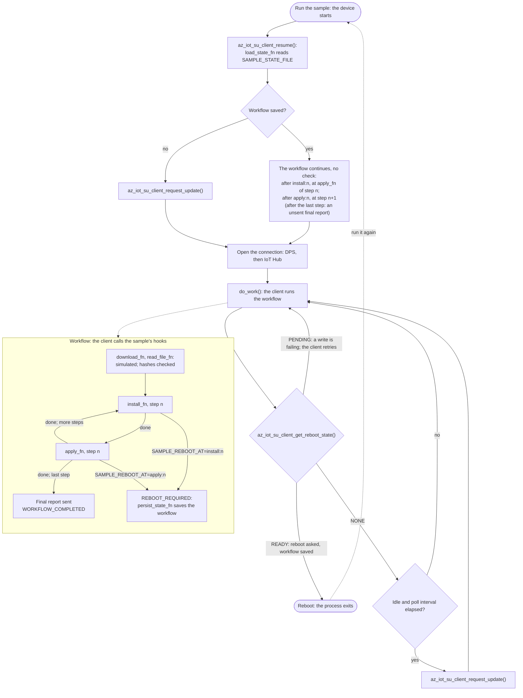

<!--
Copyright (c) Microsoft. All rights reserved.
Licensed under the MIT license. See LICENSE file in the project root for full license information.
-->

# Software Updates Sample - Reboot and Resume on PC

Some updates take effect only after the device restarts. This sample shows how a workflow
survives that restart. `install_fn` or `apply_fn` returns `AZ_IOT_SU_RESULT_REBOOT_REQUIRED`,
and the client saves the workflow through `persist_state_fn`. Once
`az_iot_su_client_get_reboot_state()` is `AZ_IOT_SU_REBOOT_READY`, the sample "reboots": the
process exits, and running it again is the device starting. `az_iot_su_client_resume()` reads the
workflow back through `load_state_fn`, and it continues. Download and the hash read-back are
simulated (zero-filled payloads); install and apply only log.



## Sample features

- Target platforms: **Linux** and **Windows**.
- `persist_state_fn` writes a file atomically (temporary file, then rename; `MoveFileExA` on
  Windows) and erases it on a zero-length write. `load_state_fn` reads it back.
- `SAMPLE_REBOOT_AT=install:<n>` or `apply:<n>` picks where a reboot is needed (1-based step).
  - After an install reboot, the step resumes at Apply.
  - After an apply reboot, the workflow resumes at the next step.
  - After the last apply, the workflow has succeeded. A new update is deferred
    (`AZ_IOT_SU_EVENT_UPDATE_DEFERRED`) until the reboot.
- The sample reboots only when the client reports `AZ_IOT_SU_REBOOT_READY`: while a state write
  is failing (`AZ_IOT_SU_EVENT_PERSIST_FAILED`) it is `PENDING`, and the client retries.
- `resume()` runs before the first update check, and no check is made while a resumed workflow
  runs. A check waits for a restored final report by itself.
- Step result details set before the reboot are reported in the final report after it, shown from
  `AZ_IOT_SU_EVENT_WORKFLOW_COMPLETED`.
- After a succeeded update, the client advertises the applied update as installed in later checks.
- A connection that faults for good ends the process (exit 1); a saved workflow resumes on the next
  run.
- Requires Azure Device Provisioning service, an Azure IoT Hub and Azure Device Update.

## Configure

| Variable | Required | Meaning |
|---|---|---|
| `AZ_IOT_DPS_ID_SCOPE`, `AZ_IOT_DPS_REGISTRATION_ID` | yes | The device's DPS enrollment |
| `AZ_IOT_CLIENT_CERT`, `AZ_IOT_CLIENT_KEY`, `AZ_IOT_TRUSTED_CA` | yes | X.509 credential and trust bundle |
| `AZ_IOT_DPS_GLOBAL_ENDPOINT` | no | DPS endpoint; default global |
| `AZ_IOT_SU_MANUFACTURER`, `AZ_IOT_SU_MODEL` | no | Compatibility; default `Contoso`/`SU-Reboot` |
| `AZ_IOT_SU_INSTALLED_PROVIDER` / `_NAME` / `_VERSION` | no | Installed update id at startup; default `Contoso/SU-Reboot/1.0.0`. A real device reads it from its image |
| `SAMPLE_REBOOT_AT` | no | `install:<n>` (default `install:1`) or `apply:<n>` |
| `SAMPLE_STATE_FILE` | no | Saved workflow; default `./su_reboot_state.bin` |
| `AZ_IOT_SU_EXIT_AFTER_WORKFLOW=1` | no | Exit once the workflow completes and storage is current (reboot state not `PENDING`): 0 when it succeeded and its report was accepted, 2 otherwise |
| `AZ_IOT_SU_POLL_INTERVAL_S` | no | Seconds between checks; default 14400 |
| `AZ_IOT_SU_LOG_LEVEL` | no | `trace`, `debug`, `info` (default), `warn`, `error`, `off` |

## Build and run

```bash
cmake --preset linux-gcc-debug
cmake --build --preset linux-gcc-debug --target az_iot_sample_software_update_reboot_resume
B=./build/linux-gcc-debug/samples/software_update/az_iot_sample_reboot_resume
SAMPLE_REBOOT_AT=install:1 $B   # installs step 0, saves the workflow, exits ("reboot")
$B                              # resumes at Apply, finishes, reports
```

With az_mqtt (`-DAZ_IOT_WITH_AZ_MQTT=ON`), target `az_iot_sample_software_update_reboot_resume_az_mqtt`
builds the same sample in `az_mqtt/` next to that binary ([adapters](../../../README.md#build)).

Size the storage behind `persist_state_fn` for `AZ_IOT_SU_STATE_BLOB_MAX_SIZE(max_update_size,
result_details_size)` bytes.

## Where to look in `main.c`

| What | Where |
|---|---|
| Atomic save, erase and load | `save_update_workflow()`, `load_saved_update_workflow()` |
| Asking for a reboot | `install_update_step()`, `apply_update_step()` |
| Resume before the first check | `az_iot_su_client_resume()` in `main()` |
| When to reboot | `az_iot_su_client_get_reboot_state()` in the main loop |
| End of a workflow | `AZ_IOT_SU_EVENT_WORKFLOW_COMPLETED` in `on_su_event()` |
