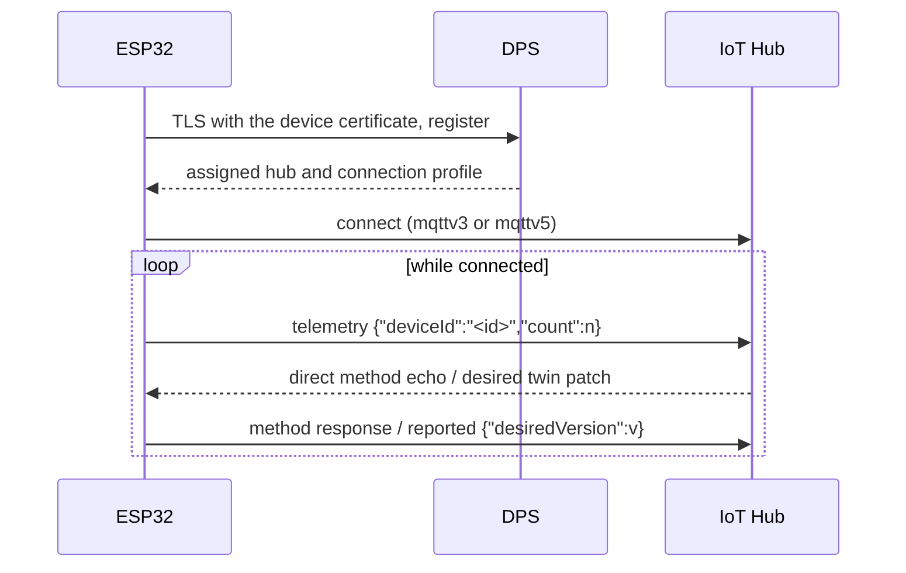

<!-- Copyright (c) Microsoft. All rights reserved.
     Licensed under the MIT license. See LICENSE file in the project root for full license information. -->

# IoT Hub Sample - ESP32

An ESP32 that provisions through DPS with an X.509 identity and then, on whichever hub DPS
assigns (mqttv3 or mqttv5):

- sends telemetry every `HUB_TELEMETRY_INTERVAL_S` seconds (`{"deviceId":"<id>","count":n}`, with
  the device id DPS assigned);
- answers the direct method `echo` with its payload (status 200, or 413 when the response would
  not fit), any other with 404 (mqttv5 refuses undeclared methods itself);
- acknowledges each desired twin version by patching `{"desiredVersion":<version>}` into the
  reported properties, including one set while it was offline: on mqttv3 it reads the twin on
  each connect; on mqttv5 the hub pushes the desired snapshot on connect. A version older than one
  already seen is ignored, except in an mqttv5 snapshot (the whole document, e.g. a replaced
  twin). A failed twin read or refused patch is retried after 5 s; on mqttv3, one unanswered for
  60 s makes the sample reconnect, which ends it, and it is then retried.

It restarts after 15 minutes without a hub connection: ESP-IDF's `protocol_examples_common` stops
reconnecting Wi-Fi after `EXAMPLE_WIFI_CONN_MAX_RETRY` failures, and a restart brings it up again.



The clients are built for mqttv3 before connecting, what DPS assigns when it names no
connection profile. If DPS assigns mqttv5, the sample rebuilds them and reconnects, as
[unified/telemetry](../telemetry/README.md) explains. Everything is in
[`main/app_main.c`](main/app_main.c).

## Prerequisites

- [ESP-IDF v6.0](https://docs.espressif.com/projects/esp-idf/en/v6.0/esp32/get-started/index.html),
  with its environment exported (`export.sh`, `export.ps1` or `export.bat`).
- An ESP32, ESP32-S3, ESP32-C3 or ESP32-C6 board with 4 MB flash, or [QEMU](#run-in-qemu).
- The `azure-sdk-for-c` submodule: `git submodule update --init c/deps/azure-sdk-for-c`.
- A DPS instance linked to an IoT Hub, with an X.509 enrollment for the device certificate.

From the ESP Component Registry, at exact versions: `espressif/esp_secure_cert_mgr` (device
identity) and `espressif/ethernet_init` (needed by ESP-IDF's `protocol_examples_common`).

## Configure

### Device identity

The device certificate and key come from the `esp_secure_cert` partition (0xD000), read by the
[esp_secure_cert certificate provider](../../../adapters/cert_esp_secure_cert/az_iot_certificate_provider_esp_secure_cert.h);
the certificate CN must equal `HUB_DPS_REGISTRATION_ID`. On ESP32-S3/C3/C6 the key stays in the
Digital Signature peripheral; on ESP32 it is a PEM key in the partition. Write the partition
after `idf.py flash` as the [software updates sample](../../software_update/esp32/README.md#device-identity)
describes; that README also covers read-protecting the DS key for production.

The DPS and hub server certificates are verified against the ESP-IDF certificate bundle.

### Settings

`idf.py menuconfig` → *IoT Hub ESP32 Sample Configuration*
([`main/Kconfig.projbuild`](main/Kconfig.projbuild)), and the Wi-Fi network under *Example
Connection Configuration*.

| Setting | Required | Meaning |
|---|---|---|
| `EXAMPLE_WIFI_SSID`, `EXAMPLE_WIFI_PASSWORD` | yes | Wi-Fi network (WPA2 or better). |
| `HUB_DPS_ID_SCOPE` | yes | DPS ID scope. |
| `HUB_DPS_REGISTRATION_ID` | yes | Registration id / device id; must equal the certificate CN. |
| `HUB_DPS_GLOBAL_ENDPOINT` | no | DPS global endpoint. Empty: `global.azure-devices-provisioning.net`. |
| `HUB_TELEMETRY_INTERVAL_S` | no | Seconds between telemetry messages. Default 10. |

## Build and run

From `c/samples/unified/esp32`:

```sh
idf.py set-target esp32c3
idf.py menuconfig
idf.py build flash monitor
```

Expected output (other lines omitted):

```
I (...) hub_esp32: IoT Hub ESP32 sample starting
I (...) hub_esp32: ready on mqttv3
I (...) hub_esp32: telemetry 1 sent
I (...) hub_esp32: method 'echo' answered 200
I (...) hub_esp32: desired version 2: {"color":"red","$version":2}
I (...) hub_esp32: desired version 2 acknowledged
```

The `hub_esp32:` lines are stable: the end-to-end tests read them.

| Symptom | Likely cause |
|---|---|
| `no device certificate in the esp_secure_cert partition; see README; rebooting` | The partition was not written, or was written at another offset. |
| `connection faulted: ...; rebooting` | DPS refused the device (CN, enrollment) or the hub refused the connection. |
| `network connect failed; rebooting` | Wrong Wi-Fi settings, or a network below WPA2. |

## Run in QEMU

QEMU emulates esp32, esp32s3 and esp32c3, but not Wi-Fi: [`sdkconfig.qemu`](sdkconfig.qemu)
switches the network to OpenCores Ethernet. From `c/`, with ESP-IDF's QEMU installed
(`idf_tools.py install qemu-xtensa qemu-riscv32`):

```sh
eng/esp-idf-build.sh samples/unified/esp32 esp32 qemu /tmp/hub
eng/esp-idf-qemu.sh /tmp/hub/unified-esp32-esp32-qemu/build esp32 "Got IPv4 event"
```

Without an identity partition in the flash image, the sample stops at
`no device certificate in the esp_secure_cert partition`.

## CI builds

CI (`ci-c`, job `esp-idf`) builds this sample for esp32, esp32c3, esp32s3 and esp32c6, and the
`qemu` profile for esp32, esp32s3 and esp32c3, which it boots in QEMU until it gets an IPv4
address. Any compiler warning fails the build.
